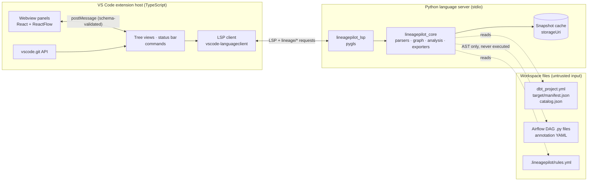

# VS Code Extension Design

**Status**: Direction approved 1 November 2026 (decisions D-1, D-3 and D-4 in section 15). Engineering details may still change at gate G0.
**Date**: 1 November 2026
**Name**: LineagePilot, chosen 1 November 2026. On that date nothing used the name on the VS Code Marketplace or Open VSX, and `lineagepilot`, `lineagepilot-core` and `lineagepilot-lsp` were free on PyPI. A trademark search is still needed before the public release.
**Companion**: [implementation_plan.md](implementation_plan.md)

---

## 1. Summary

Data Capsule is currently a hosted metadata server. This design turns it into a local VS Code extension that answers one question in the place where the change is made:

> If I change this dbt model or column, what breaks across downstream models, exposures and Airflow tasks, and how sure are we?

For the MVP, the extension reads only the dbt artifacts already in the workspace. It needs no server, no database and no credentials. It runs the existing Python parsers in a local language server and shows impact in five places:

- CodeLens
- Hovers
- The Problems panel
- A lineage graph
- A change-impact review that can be pasted into a pull request

**Reused**:
- The dbt, SQL and annotation parsers (about 2,800 lines, already independent of the database).
- The conformance rules that apply to dbt.
- The PII heuristics.
- The graph exporters.
- The ReactFlow lineage components (about 2,300 lines).

**Retired**:
- The FastAPI server, PostgreSQL schema, Next.js app, API-key authentication and BFF proxy.
- The CRUD-only entities (contracts, policies, SLAs, products, glossary).

---

## 2. Positioning

### What already exists (checked 1 November 2026)

| Tool | What it covers | Gap relevant to us |
|---|---|---|
| dbt Labs official VS Code extension [S1, S2] | Free. Model lineage. Requires the Fusion engine. Column lineage is marketed, but the official supported-features table lists it as "coming soon". | dbt only. No orchestration awareness. Fusion only. |
| dbt Power User (Altimate) [S3] | Model and column lineage, project health checks. Works with dbt Core. | dbt only. No dedicated change-impact review. |
| Altimate Code Actions, Atlan dbt action [S4] | Impact of dbt changes posted to pull requests. | GitHub Actions, not in the editor. dbt only. Atlan's action needs an Atlan instance. |
| Cartographer CLI [S5] | Maps a diff to dbt models and Airflow tasks. | A CLI with an MCP server, not an editor extension. Early version (0.9). |
| Airflow VS Code extension [S6] | Triggers DAGs, views logs. | No dbt or lineage awareness. |

### Implication

dbt-only lineage in the editor is **table stakes, not a differentiator**. We build it because users expect it, but the product wins only on three things that, as far as the search found, no single extension does together:

1. **Impact across tools.** Show which Airflow DAGs and tasks orchestrate or consume a dbt model, alongside its downstream models and exposures.
2. **A change-impact review of the working diff.** It shows explicit evidence and explicit unknowns, and can be exported to the pull request.
3. **Works on dbt Core artifacts, offline**, with no SaaS account.

Architecture conformance and PII indicators are supporting features, surfaced as diagnostics.

**Main competitive risk:** dbt Labs or Astronomer (who make Cosmos) adding Airflow awareness. The plan therefore validates the cross-tool wedge with users at gate G0, before the expensive phases.

---

## 3. Goals and non-goals

### MVP goals

| # | Goal |
|---|---|
| G1 | Index a dbt project from `target/manifest.json` and `catalog.json`, in both trusted and restricted workspaces. |
| G2 | Model- and column-level lineage through CodeLens, hover, a tree view and a graph webview. |
| G3 | A change-impact review of the branch and working-tree diff, with evidence classes and Markdown export. |
| G4 | Link dbt nodes to Airflow tasks by statically analysing DAG files in the workspace and by reading annotation files. |
| G5 | Conformance and PII indicators as diagnostics, using five result states (section 5.3). |
| G6 | Run in VS Code, Cursor, Windsurf and VSCodium, published to both the Marketplace and Open VSX. |

### Non-goals for the MVP

- A multi-user server, authentication or tenancy.
- Warehouse connections, including Snowflake.
- Live Airflow REST (post-MVP option).
- Catalog, glossary, contracts, policies, SLAs, data products, redundancy "savings" and impact-simulation percentages. The commercial review flagged the last two as unmeasured heuristics (F13).
- Editing dbt files, beyond trivial quick fixes after the MVP.
- AI features and BI connectors.

---

## 4. Architecture



**Process model**: one language server per dbt project, that is per folder with a `dbt_project.yml` in any workspace folder. Usually that is one per workspace folder; a repository with several dbt projects gets one each, so a failure in one never affects another (task 2.1). Multi-root workspaces work the same way. The transport is **stdio only**: the extension never opens a network port.

The server is told at initialise which project it serves, whether the workspace is trusted, and where to cache snapshots (`context.storageUri`). It indexes in a child process (section 11), and the editor watches the files for it: `target/manifest.json` and `catalog.json` (re-index, debounced), `dbt_project.yml` (follow moved paths), the files dbt reads to build the manifest (the staleness warning), `.lineagepilot/rules.yml` at the project root (re-run the rules), and the Airflow DAG folders and `.lineagepilot/airflow.yml` (read the DAG files again).

### 4.1 Components

| Component | Language | Responsibility |
|---|---|---|
| `extension/` | TypeScript | Activation, interpreter discovery, language-server lifecycle, commands, tree views, status bar, git integration, webview host. After the MVP, also connector secrets in SecretStorage. |
| `extension/webview/` | React | Lineage graph and column lineage, built from the existing ReactFlow components, and the change-impact review, a page of its own with no graph to pay for. |
| `packages/lsp` (`lineagepilot_lsp`) | Python (pygls) | Standard LSP features (CodeLens, hover, diagnostics), plus the custom `lineage/*` requests. |
| `packages/core` (`lineagepilot_core`) | Python | Parsers, `MetadataGraph`, analysis (lineage, impact, rules, PII) and exporters. Editor-agnostic and headless, so it can also run in CI. |

### 4.2 Decision D-2: why a Python language server

| Option | For | Against |
|---|---|---|
| **A. Python LSP sidecar (recommended)** | Reuses the parsers and sqlglot. LSP gives diagnostics, hover and CodeLens natively. The same server can serve Neovim and JetBrains (via LSP4IJ) later. dbt Core and Airflow users already have Python. | Needs Python 3.10 or later. Two languages to maintain. |
| B. TypeScript rewrite | No Python dependency. | No TypeScript SQL parser comes close to sqlglot's dialect coverage. Means rewriting about 5,000 lines of parsing, at roughly 2–3× the effort. |
| C. Embed the FastAPI server on localhost | Maximum reuse. | Drags in PostgreSQL and SQLAlchemy. A local HTTP port reintroduces the DNS-rebinding and CSRF class of problems the BFF proxy had. Heavy dependencies. |
| D. Thin client to a hosted server | Smallest extension. | Keeps all the server's security and operations debt. Contradicts the reason for the pivot. |

**Risk for option A**: users who run only dbt Fusion may not have Python installed. Mitigation:
- Offer a uv-managed interpreter (downloaded only with the user's consent).
- Keep the core behind a stable JSON protocol, so the hot path could later be ported without changing the extension.

### 4.3 Decision D-2a: storage

The core keeps an in-memory `MetadataGraph`, rebuilt from the artifacts. It is snapshotted to `context.storageUri` using stdlib `sqlite3` or JSON, keyed by the manifest hash. The snapshots serve two purposes: fast warm starts, and stored baselines for change review.

There is no PostgreSQL and no ORM. With a single user, the artifacts are the source of truth. Removing the ORM also removes the field-name drift behind the review's findings F05 (obsolete `ColumnLineage` fields) and F06 (a row dictionary passed where a URN was expected).

### 4.4 Decision D-2b: packaging the Python side

Bundle **pure-Python** dependencies into `bundled/libs` with:

```
pip install --target bundled/libs --implementation py --only-binary=:all: --no-deps --require-hashes -r requirements.lock
```

This is the pattern Microsoft's Python tools extension template uses [S7], and it gives a single universal VSIX with no per-platform builds.

Spike S1 found that the template's command is not enough. Without `--only-binary=:all:`, pip silently builds sdists: PyYAML came out macOS-only, with a native `_yaml.so` in a "universal" bundle. The bundler (`scripts/bundle_libs.py`, from S1) therefore does four more things:
- It builds PyYAML, which has no pure wheel, from its hash-pinned sdist, with `PYYAML_FORCE_LIBYAML=0` and no build isolation. The only build dependency is a hash-pinned setuptools.
- It installs every locked package regardless of environment markers. That way, Python 3.10 backports such as `exceptiongroup` are present whichever Python builds the bundle.
- It fails the build on any compiled file or non-`py3-none-any` wheel tag.
- It writes `BUNDLE.json`, listing versions and hashes.

The packaged VSIX is checked again before release.

| Kept at runtime | Dropped |
|---|---|
| `sqlglot`; `pygls` with `lsprotocol`, `cattrs` and `attrs` (plus `typing_extensions` and `exceptiongroup`); `PyYAML` as a pure-Python build; `orjson` only if it is already importable (stdlib `json` otherwise) | fastapi, uvicorn, sqlalchemy, asyncpg, alembic, pydantic, httpx, snowflake-connector, typer, rich, structlog, prometheus, opentelemetry |

S1 measured the result: 8 packages, a 1.36 MB VSIX, and 0 compiled files. Startup to the first CodeLens takes about 0.45 s cold and 0.23 s warm.

**Launch**: the server runs as `python -I bundled/tool/lsp_server.py`, with the extension's directory as its working directory, and puts `bundled/libs` first on `sys.path`. Isolated mode keeps a workspace `yaml.py`, the user site-packages and `PYTHON*` variables from shadowing the bundle.

**Interpreter resolution, in order**:
1. The `lineagePilot.python.interpreterPath` setting. It is machine-scoped, so a workspace cannot set it (section 10). If it is set but unusable, that is an error, not a silent fallback.
2. The active environment from the Python extension, via `@vscode/python-extension`.
3. `python3` on `PATH` (on Windows, `py -3` and then `python`). On macOS, VS Code takes `PATH` from the login shell.
4. A Python that uv has already installed, found with `uv python find --no-project` and no download; then, only if the user agrees, one that uv downloads (`uv python install 3.13`).

In an untrusted workspace, a candidate inside a workspace folder is never run, not even to probe its version (section 10). Commands found on `PATH` are resolved to absolute paths first, so a workspace directory on `PATH` cannot slip a `python3` past the check (task 2.4); the setting gets the same check, and so does uv itself.

Minimum Python version: 3.10.

---

## 5. Core data model

### 5.1 Identity

This answers the review's F09: today, URNs from different sources do not reconcile.

| Node kind | ID |
|---|---|
| dbt node (model, source, seed, snapshot, exposure) | Logical: the dbt `unique_id`, for example `model.shop.orders` |
| Physical relation | Normalised `database.schema.identifier`, taken from `relation_name` |
| Column | `<node id>#<column name>`, normalised to the adapter's case rules |
| Airflow DAG / task | `airflow:<dag_id>` / `airflow:<dag_id>.<task_id>`, plus the file path |

Logical-to-physical mappings are stored as explicit edges, so a dbt model and the warehouse table it builds stay connected without colliding.

### 5.2 Edges and evidence

| Edge | Meaning |
|---|---|
| `depends_on` | dbt node → dbt node (from the manifest) |
| `derives` | column → column, with a transformation type |
| `materialises` | logical node → physical relation |
| `orchestrates` | Airflow task → dbt node(s) it runs or reads; `transformation` says how (`dbt run`, `dbt, through Cosmos`, `reads`, `writes`, or an annotation's `consumes`, `produces`, `transforms`, `validates`) |
| `task_depends_on` | Airflow task → the task that runs after it, and a task → the group it is in |

Every edge and every finding carries an evidence record:

| Field | Values |
|---|---|
| `origin` | `manifest`, `compiled_sql`, `catalog`, `dag_static`, `annotation` |
| `confidence` | `declared` (the artifact states it), `inferred` (derived by parsing), `heuristic` (pattern-based) |
| `artifact_version` | Manifest `generated_at`, `dbt_version` and the hash of the source file |
| `location` | File and range, used for navigation |

**Unresolved references are first-class records**, shown to the user and never silently dropped. The review's F07 found output columns being dropped this way, with only a debug log line.

### 5.3 Rule results

Every rule produces one of five results: `pass`, `fail`, `not_applicable`, `unsupported` or `unknown`.

- The score denominator **excludes** `unsupported` and `unknown`.
- Coverage is always shown next to the score.
- In the Problems panel, failures show with the rule's severity, `unknown` results as information ("Not checked") and `unsupported` ones as hints, each linking to its rule in [rules.md](rules.md) (task 2.2).

This fixes the review's F11 (unsupported checks counted as passes). Rule packs live in a workspace file, `.lineagepilot/rules.yml`, so custom rules persist by construction. That fixes F10 (custom rules lost after the request that created them).

---

## 6. Data sources

### 6.1 dbt (MVP)

- **Discovery**: find projects by `dbt_project.yml`. Read `target/manifest.json`, `catalog.json` if present, and compiled SQL from the manifest's `compiled_code` or `target/compiled/`.
- **Staleness**: if a model file is newer than the manifest, the status bar warns.
- **Refresh**: the "Refresh dbt artifacts" command runs `dbt parse` or `dbt compile`. It is available in **trusted workspaces only** and always uses a user-configured executable, never a workspace-configured one.
- **Column lineage**: `sqlglot.lineage` over compiled SQL, using the dialect from `adapter_type` and a schema built from `catalog.json`. Spike S2 found that the existing `sql_column_parser` returns a single `*` for 86–100% of compiled dbt models, so it is not reused. `sqlglot.lineage` with a catalog schema resolved 91–99% of columns, in at most 0.35 s per model. A model that cannot be parsed, or that has no catalog, shows as `unknown`, not as having no lineage.
- **Versions**: manifest schema **v12** is supported. Spike S2 found that dbt Core 1.8, 1.9, 1.10, 1.11 and 1.12 and Fusion 2.0.9 all write v12. The check uses `metadata.dbt_schema_version`, never `dbt_version`, because Fusion reports `dbt_version` 2.0.x.
  - A newer schema version gets a warning, a best-effort parse and structural checks; if the checks fail, the index is marked `unknown`.
  - An older one gets a warning that it is untested.
  - Fusion is stricter about YAML and omits some keys, such as column `data_type`, but none that the parser reads.

### 6.2 Airflow (MVP: static analysis)

DAG files are parsed with Python's `ast` module. **They are never imported or executed.** The scanner detects:

- Astronomer Cosmos `DbtDag` and `DbtTaskGroup`: the project path and select/exclude arguments.
- `BashOperator` and `KubernetesPodOperator` commands that invoke `dbt run`, `dbt build` or `dbt test --select ...`.
- SQL operators with literal SQL, resolved to table references with sqlglot.
- Task dependencies from `>>`, `<<`, `set_upstream`, `set_downstream` and `chain()`, where the operands resolve to known tasks.

Dynamic DAGs (loops, factories, templated selectors) produce `unknown` records rather than guesses.

**What spike S3 changed** (1 November 2026). Literal operands alone are not enough: a scanner limited to literals missed 19 of 84 links (22.6%) on the three sample repositories. The scanner therefore also resolves, still with the AST only:
- constants imported from other workspace modules;
- `Path(__file__)` arithmetic, and environment-variable defaults (confidence `heuristic`);
- one level of inlining for local helper functions called with literals;
- the working directory of a `BashOperator` (`cwd`).

Remapping container paths was the largest single fix, recovering 15 of the 84 links. It works two ways:
- `/usr/local/airflow`-style paths are matched to workspace folders by suffix, as `heuristic`.
- An explicit path map goes in the annotation file.

Other rules from S3:
- **Heuristic is the normal confidence.** 71 of the 75 correct links were `heuristic`, so the review shows heuristic links by default, labelled as such.
- **Cosmos links come from the manifest.** A Cosmos link is stored once, at group level. Its per-model task ids are derived from the manifest, including which models have tests. The mapping is pinned to a Cosmos version range, and the S3 README documents it.
- **dbt-loom external nodes are excluded.** They have no file, and linking them gives false positives.
- **Selector semantics follow the manifest's dbt version.** dbt 1.10 changed wildcard matching. A `dbt ls` conformance test runs in CI.
- **File discovery matches Airflow's.** That means the safe-mode heuristic, `.airflowignore`, and skipping dbt project folders.
- **Unknowns are named.** The categories: remote manifest (`s3://`, `gs://`, `abfs://`), tasks generated from `manifest.json` at parse time, wrapper class, loop or factory, generated project, unsupported selector, Jinja, and a DAG that cannot load. Each is reported at the call site.

S3's evidence is in-sample: the scanner was built while reading the same repositories. A held-out corpus of 10 or more repositories, labelled before tuning, is the Phase 5 exit test (beads LP-56q.5).

**What the held-out corpus found** ([corpus/README.md](../corpus/README.md)). On 106 links in 17 unseen repositories, the frozen scanner got 17 right, a miss rate of **84.0%**: 78 links were reported as unknown at the line that caused them, 9 left no record, 2 were wrong, and there were no false positives. So S3's 0% says little about other repositories. The scanner rarely misleads, but it often cannot tell. Three general gaps make up 62 of the 89 misses: `os.environ["AIRFLOW_HOME"]` with no default (LP-0o1), helpers imported from another file (LP-z2x) and container paths that match no project by their tail (LP-c05). After the freeze only the silent links were changed, into unknowns, because silence breaks the plan's definition of done. The correct count did not move. A tuned scanner needs a fresh corpus (LP-aax): this one has now been read.

**Reused**: `data_flow_annotations.py` (YAML mappings for anything the scanner cannot see). **New**: the `lineagepilot_core.airflow` package, with `dag_static.py` at its centre, grown from the spike. It takes over from `dbt_manifest_resolver.py`, whose selector rules were a simplification S3 showed to be wrong.

**What Phase 5 added to the spike** (task 5.1), none of it from reading the held-out corpus:

- **SQL operators.** The SQL of `SQLExecuteQueryOperator`, `SnowflakeOperator`, `PostgresOperator`, `BigQueryInsertJobOperator` and the like, literal or in a `.sql` file beside the DAG, is parsed with sqlglot in the project's dialect. A task gets an `orchestrates` edge to each dbt node whose table it reads or writes. A name in full is `inferred`; part of a name is `heuristic`, and only counts if exactly one relation ends with it. A templated value such as `{{ ds }}` is fine; a templated table name is not.
- **Owners**, from `owner=` and `default_args`, for the review.
- **dbt inside another command**: `docker exec`, `docker compose run`, `kubectl exec`, `ssh`. The working directory there says nothing, so the project comes from `--project-dir`, or from being the only one.
- **A shell variable** in a selector (`--select $MODEL`) is as unknown as Jinja. It used to be taken for a model's name, and select nothing.
- **Any other operator that mentions dbt**, such as `DbtCloudRunJobOperator`, is an unknown rather than nothing.
- **Hostile input.** A crafted file can only get a wrong answer: strings and lists it builds are capped, each file has a budget of evaluation steps, a format string cannot reach attributes or allocate memory, and a symlink to a device or a FIFO cannot block. A failure on one file costs that file, and says so. `.airflowignore` patterns go through the safe regex (section 10) and are also read as globs, which Airflow 3 defaults to; a repository does not say which it runs on, and what is skipped is reported.

**What a `dbt test` task links to** (decided in Phase 5; S3 left it open). The selected models that have at least one test. dbt's eager indirect selection also runs tests that belong to other models, such as a `relationships` test whose other parent was not selected. Those are not linked: the task is about the models it was told to select, and the other parent's own tasks are what a reviewer needs for it.

**Where DAG files are looked for.** `lineagePilot.airflow.dagFolders`, relative to the workspace folder. The default, `**/dags`, finds any folder called `dags` up to six levels down, because most monorepos keep theirs below something like `airflow/`. The workspace is what DAG files and the modules they import must be inside, and may be larger than the project: `dags/` beside `dbt/`. When no file is found the review says where it looked.

**The annotation file** is `.lineagepilot/airflow.yml` at the project root (task 5.2), the way out of every unknown:

```yaml
path_map:                         # where a path in a DAG file really is, relative to the project
  /usr/local/airflow/dbt: .
pipelines:                        # what the scanner cannot see
  - pipeline_id: finance_gl
    owner: finance-eng
    tasks:
      - task_id: load_gl
        consumes: [model.finance.stg_accounts, analytics.staging.raw_transactions, stg_orders]
        produces:
          - urn: analytics.facts.gl
            operation: insert
acknowledged:                     # unknowns a person has answered
  - file: dags/factory.py
```

A reference is a dbt ID, a table name or a model's name if it is unique; one that matches nothing is an unknown, not dropped. An annotated task's own unknowns count as answered. It is data, like the manifest, so it loads in Restricted Mode too, and a path map cannot leave the workspace.

**A scan sits on top of the graph, and is never in a snapshot.** A DAG file changes far more often than the manifest, and re-indexing column lineage for it would cost seconds at best. So the language server reads DAG files in a child process of their own (section 11) and applies the result to whichever graph is loaded; the model-level and full graphs of one manifest share one scan. It starts again when a DAG file or the annotation file changes, and when a new manifest arrives, because selectors are evaluated over a manifest. A module imported from outside the DAG folders is not watched: **Re-index Lineage** picks that up. Only DAGs that touch this project become nodes, with all their tasks; a link to another dbt project in the workspace is left to that project's server, which reads the same files.

**After the MVP**: live Airflow through the existing REST parser, with connection settings that a workspace cannot override and tokens in SecretStorage (section 10).

### 6.3 Warehouses

Post-MVP. If the Snowflake parser returns, its SQL construction must be fixed first: bind parameters for values, quoted identifiers for names, and no caller-chosen role (beads DCS-x9w).

---

## 7. User experience

| Surface | Behaviour |
|---|---|
| Activation | `workspaceContains:**/dbt_project.yml`, or on command. |
| CodeLens (model SQL, `schema.yml`) | `↓ 14 models · 3 Airflow tasks · 1 exposure · PII`. Clicking opens the impact view for that node. |
| Hover on `ref()` / `source()` and on select-list columns | Upstream and downstream summary, with the evidence class for each edge. |
| Sidebar tree views | **Lineage** (upstream and downstream of the active file) and **Airflow** (the DAGs and tasks that run or read the active file's nodes, or all of them when it has none, each with how sure the link is and why, then what could not be read). |
| Lineage graph webview | **Show Lineage Graph** (command palette, or a node in the Lineage view). Model and column modes, a depth and direction control, filters by node kind, a highlighting search, auto-layout and lazy expansion (+). Clicking a node shows its details and previews its file at the node's range beside the graph; double-click, O or **Open** opens it. Arrow keys follow the edges. Follows the VS Code theme. |
| Problems panel | Conformance and PII diagnostics on model and `schema.yml` files, each with its rule ID, mapped severity and a docs link. |
| **Change Impact Review** panel | **Review Changes** (command palette, or the compare icon on the Lineage view). **Change base** picks a branch or tag, defaulting to the merge-base with the default branch. Shows changed nodes with their columns as a diff, then downstream impact grouped by dbt models, exposures, Airflow tasks and owners, each row with how it was reached, its confidence (the graph's line styles) and its evidence, then an **Unknowns** section. **Run dbt compile** appears when a changed model is newer than the manifest, in a trusted workspace. **Copy as Markdown** copies the review for the pull request. It updates by itself when the index or the working tree changes. In Restricted Mode VS Code's Git extension is off, so the panel says it cannot tell what changed, and offers **Manage Workspace Trust**. |
| Status bar | `Lineage: 1,204 nodes · manifest 3 min old`, or a stale-artifact warning. |
| Commands | Show lineage · Analyze impact of current model · Review changes · Refresh artifacts · Export graph (JSON / Mermaid / DOT / GraphML / Cypher) · PII inventory (Markdown / CSV). |

Navigation features that competitors already have (go-to-definition for `ref()`, model previews) stay out of the MVP. They would be added only if beta users ask, since they do not differentiate the product.

---

## 8. Change-impact review: algorithm

1. **Changed files**: diff from the merge-base with the default branch to the working tree, including untracked files, using the VS Code git API. The base is the first of `origin/HEAD`, `origin/main`, `origin/master`, `main` and `master` with a merge-base, or a ref the user picks, and it is always the merge-base of `HEAD` and that ref, so commits on the other branch do not count as this branch's changes.
2. **Files to nodes**: map changed files to nodes using the manifest's `original_file_path` and `patch_path` (for `schema.yml`). A renamed file also maps through its old path, while the manifest is older than the rename.
   - A file that defines a node (`definition`) is compared and followed downstream.
   - A YAML file that only describes nodes (`properties`) is listed but not followed. It documents the data rather than changing it, and one file often documents dozens of models. That is stated under **Unknowns**, for the case where it does change the data, such as the table a source reads.
   - A file no node maps to is an **Unknown** if it could change one: a macro, `dbt_project.yml` or `packages.yml`, a new model the manifest has not seen, or a deleted file no artifact knows. Anything else is listed under "other changed files". dbt's own output under `target/` is left out.
3. **Column changes**: compare each changed node's current output columns, from compiled SQL, with a baseline. Baselines in priority order, per node:
   1. A baseline manifest from `lineagePilot.baseline.manifestPath` (typically the production manifest used for `--state`). Its compiled SQL gives what the node selected; a node it does not have is new. It is read in a child process, like an index, and only for the changed nodes. One that cannot be read is an **Unknown**, and the next baseline is used.
   2. Columns from `catalog.json`, which reflect what is actually deployed.
   3. Model level only, with every column marked `unknown`.

   Compiled SQL only counts if the manifest has seen the file's current text; otherwise the comparison would miss the very change under review, and report that nothing changed. So the file is compared with the manifest's `raw_code` by hash, stripped as dbt strips it and with line endings normalised: git checks the same file out with CRLF on Windows and LF elsewhere, and a manifest built on one must not call the file stale on the other. If they differ, the node's columns are `unknown` and the panel offers `dbt compile`. The check is on content, not modification times, so it gives the same answer in a fresh CI checkout, and undoing an edit clears it. It is not the manifest's own `checksum`, which on real dbt 1.12 and Fusion manifests matches neither the file nor `raw_code`. A snapshot's `raw_code` is only its block, so snapshots stay `unknown`.

   What a model selects is recorded on the graph at index time (`output_columns`), from the lineage trace or, without a catalog, from qualifying the SQL alone, which expands `select *` over a CTE but not over a table. So a developer who ran `dbt compile` but never `dbt docs generate` still gets a comparison against a baseline manifest. The comparison is by name, folded to the adapter's case rules, and by type where the baseline and the current graph both state one.
4. **Traverse downstream** on the current graph: use column edges where they exist, and fall back to model-level edges marked `inferred`. Two traversals are merged. Changed columns follow column lineage, which says what breaks. Then everything else below a changed node is listed at model level, with the reason, because comparing names cannot rule out a change in how an unchanged column is computed (LP-85e would narrow this). A removed column stays in the graph while the catalog lists it; once it is gone, nothing can be traced from it and its dependents are reached at model level.
5. **Cross into Airflow** through the `orchestrates` edges, then along `task_depends_on` to the tasks that run after. Group the results by DAG, and take owners from `meta.owner` or `group`, and for a task from `owner=` or `default_args`. Heuristic links are shown by default and labelled, with why: most correct links are heuristic (section 6.2), so hiding them would hide most of the real ones. A Cosmos DAG or group is one row, with the task ids derived for what it runs. Every unknown from the DAG files is listed in every review, because a task whose selector cannot be read may run any node; a task whose command cannot be read and does not mention dbt is only counted, or one line each would bury the rest. When DAG files were not read, the review says why (none found, still being read, or the reader failed) rather than that no task is impacted. A changed DAG file is listed as another changed file and not followed (LP-o59).
6. **Emit a structured result** as JSON, rendered as Markdown. A headless CLI entry point (`lineagepilot review`) produces the identical output for CI.

The output is deterministic: the same inputs always give the same review, with stable sorting and IDs, so reviews can be compared across pull requests. It holds nothing about the machine or the time: paths are relative to the project, and the language server adds where to open each node as a separate field (`locations`), left out of `lineagepilot review --json` and the Markdown. An end-to-end test compares the panel's response with the command's output on the same repository, Markdown and JSON, and a golden file pins the text.

**Markdown is untrusted output.** Names, paths and reasons come from the workspace, and the text is pasted where other people read it and where GitHub renders it. So workspace text only reaches the page as a code span (in which nothing renders, and `@team` mentions nobody) or with its punctuation escaped and any mention broken up; control and bidirectional characters are removed. sqlglot's error messages carried terminal escape codes, which are stripped where they are made. A long list is cut, with a count, to stay under GitHub's limit of 65,536 characters on a comment. Hypothesis tests that any name keeps the tables and the structure intact.

---

## 9. Protocols

### Language server ↔ extension

Standard LSP, plus versioned custom requests. The client lists the `lineage/*` protocol versions it speaks in `initializationOptions.protocolVersions`; the server picks the newest it also speaks and returns it in `capabilities.experimental.lineagePilot.protocolVersion`, or null, in which case every `lineage/*` request fails with `ProtocolMismatch` while the standard features keep working (task 2.3).

| Method | Parameters | Returns |
|---|---|---|
| `lineage/status` | none | State, node and edge counts, artifact versions and ages, staleness, unresolved count |
| `lineage/graph` | `root` (node or column), `direction` (`upstream`, `downstream` or `both`), `depth` (1–10), `granularity`, optional `maxNodes` (at most 5,000) | Nodes with navigation targets, edges with evidence, unknowns, `truncated` |
| `lineage/impact` | `targets[]` (1–200), optional `maxDepth` | Impacted nodes with confidence and columns, counts, unknowns, the column-lineage stage |
| `lineage/export` | `format`, optional `root`, `direction`, `depth` | File name and text content |
| `lineage/nodesForFile` | `uri` | The nodes a file defines or documents (tree view, "Analyze impact of current model") |
| `lineage/node` | `id` (node or column) | The node, its columns (type, description, PII, test count) and its direct upstream and downstream counts (the graph's details panel and column picker; Phase 3) |
| `lineage/refresh` | none | Status |
| `lineage/indexUpdated` (notification) | Status | none |
| `lineage/reviewChanges` | `changedFiles[]` (at most 20,000: `uri`, `status`, `previousUri`), `baseline` (`ref`, `commit`, `manifestPath`) | A review result (section 8), and where to open each node |
| `lineage/airflow` | `nodes` (at most 200, or null for all) | The DAGs and tasks touching them, each with how, confidence, notes and where to open it, the unknowns, and what the scan read |

Errors carry the protocol's codes: `NotReady` (-32001, no graph is loaded, with the reason), `UnknownNode` (-32002, the graph has no such ID, perhaps after a re-index) and `ProtocolMismatch` (-32003); malformed params get the standard `InvalidParams`.

`protocol/lineage-protocol.schema.json` is the single source. `protocol/generate.py` writes zod schemas for the extension and dataclass validators for the server from it, and CI fails if either is out of date. Each side validates everything it receives, and both are tested against the same contract examples (`protocol/examples.json`). Free text from the workspace is cut to 4,000 characters by the server.

Every request carries a `params` object, even an empty one. Spike S1 found that vscode-languageclient omits `params` when none are given, and pygls 2.1 then fails to decode the request and never replies, so the call hangs. The server's decoder now treats a missing `params` as null, so such a request is answered with `InvalidParams` instead of hanging.

### Webview ↔ extension

`postMessage` with a typed, zod-validated message union (`extension/src/webviewMessages.ts`); each side validates everything it receives and drops what does not match. The webview never talks to the language server directly:

| From the webview | The extension |
|---|---|
| `ready` | Answers `init`: the project, the focus asked for (if any), the saved view settings and the index generation |
| `graph`, `impact`, `node` (with a request ID) | Forwards `lineage/graph`, `lineage/impact` or `lineage/node` and answers `graphResult`, `impactResult` or `nodeResult`, or `error` with the protocol's code |
| `openFile` (`location`, `preserveFocus`) | Opens the file at the location's range, in an editor group other than the graph's. A click sends `preserveFocus`: the file is previewed and the keyboard stays in the graph. Only `file:` URIs inside the workspace folder: a DAG file is often beside the project |
| `saveSettings` | Keeps the view settings (global state) |

The extension also sends `focus` (show another node; one panel per project) and `indexUpdated` (re-indexed: the view reloads).

The Change Impact Review has its own page and its own messages (`extension/src/reviewMessages.ts`), validated the same way:

| From the webview | The extension |
|---|---|
| `ready` | Answers `init` (the project, whether the workspace is trusted), then the last review, or runs one |
| `refresh`, `pickBase` | Reviews again; shows a quick pick of branches and tags and remembers the choice per project |
| `copyMarkdown` | Copies the text the server rendered. The message carries no text, so a page cannot put anything else on the clipboard |
| `openFile` (`location`) | As for the graph: only `file:` URIs inside the workspace folder, in another editor group |
| `showInGraph` (`id`) | Runs **Show Lineage Graph** on that node |
| `runCompile`, `manageTrust` | Runs **Refresh dbt Artifacts** with `compile`, the guarded command, refused in Restricted Mode; opens VS Code's trust editor |

The extension sends `reviewStarted`, then `reviewResult` or `reviewFailed` (with the kind of problem, such as `restricted` or `no_base`, and words for it), and `copied`.

Unless a panel retains its context, which costs memory, VS Code destroys a hidden webview's page and builds it again when it is shown. So the webview keeps its focus, depth and direction in VS Code's webview state (`setState`) and restores them, validated, when its page is rebuilt; and the panel treats a hidden page as not ready, holding a focus asked for meanwhile until the new page's `init`.

---

## 10. Security model

**Threat model**: the main untrusted input is **the workspace itself**. A cloned repository can contain a crafted manifest, SQL, DAG files, rule packs and `.vscode/settings.json`. The hosted server's network attack surface disappears with this design; the workspace becomes the attack surface instead.

| Control | Design |
|---|---|
| Workspace Trust | `capabilities.untrustedWorkspaces.supported = "limited"`. Restricted mode only reads and parses artifacts: no dbt execution, built-in rules only. The interpreter and dbt-executable settings are listed in `restrictedConfigurations`. |
| Workspace interpreters | A cloned repository can commit a `.venv`, and the Python extension may select it. In an untrusted workspace, the extension never runs an interpreter inside a workspace folder, not even to probe its version. It checks the candidate path before probing and the resolved `sys.executable` after. |
| Setting scopes | Interpreter path, dbt executable and any future connection URL are **`machine`-scoped**, so workspace settings cannot set them. This closes the class of the server's Airflow `base_url` credential exfiltration (DCS-99m), where whoever chose the URL received the credential. The baseline manifest path is `resource`-scoped, because a team may keep one in the repository, and listed in `restrictedConfigurations`, so an untrusted workspace cannot choose it. The server trace (`lineagePilot.trace.server`) is `machine`-scoped too, so a workspace cannot turn on the verbose log that the bug report form asks users to paste. |
| Git | The extension only reads, through `vscode.git`, which VS Code turns off in Restricted Mode: the review then says it cannot tell what changed. `lineagepilot review` runs read-only git commands with arguments, never a shell. A `git` found inside the project is refused, and a ref cannot be taken for an option. Nothing in the repository's `.git` can make these commands run a program: `core.fsmonitor`, hooks (`git diff` writes the index, which runs `post-index-change`), every configured filter driver, external diff, textconv and the pager are off, a submodule's work tree is not opened, and the objects a partial clone lacks are not fetched (LP-SEC-07). A `.git` folder that arrived with the files, from an archive or a shared folder (a clone never copies one), is still unsafe to run git in: other git commands, and other tools that run git, can run what it names. To check a changed file against the manifest the review reads it only if it is a regular file inside the project and under 5 MB: a repository can hold a symlink to `/dev/zero`, which reports size 0 and never ends. |
| Secrets (post-MVP connectors) | Held only in VS Code SecretStorage, never in settings or environment variables. Each secret is bound to the host it was entered for. |
| Network | No listener, stdio only. No outbound network in the MVP. There is no telemetry (decision D-7). If it is ever added, it must respect `vscode.env.isTelemetryEnabled`. The closed beta's opt-in usage counts, which stayed on the user's machine, were removed at the first public release (0.2.0); on activation the extension deletes any it had stored. |
| Code execution | DAG files are analysed with the AST only; user Python is never imported. Every integration test configuration, Restricted Mode included, has a DAG file that leaves a marker if it is ever imported or run. dbt runs only on an explicit user command in a trusted workspace. |
| DAG files | Read as bytes, regular files inside the workspace only, under 2 MB. Strings and lists a file builds are capped, each file has a budget of evaluation steps, format strings cannot reach attributes or allocate memory, and no more than 5,000 files are read. A module is imported only from inside the workspace, as syntax. The scan runs in a child process with a time limit. Nothing about the machine reaches its result, and nothing from a file is echoed into it: an `.airflowignore` line that cannot be used is reported by its number. |
| Paths from the workspace | A path written in a DAG file, an annotation file, `dbt_project.yml` or the manifest, or met as a symlink, is followed only while it stays inside the workspace (for a dbt node, the project). It is checked as a string before any filesystem call, then each symlink's target is read and checked before it is followed, so nothing outside is ever passed to `stat` or `open`: on Windows a `stat` of `//host/share` can open an SMB connection and send the user's credentials. The DAG folder setting is a relative pattern of bounded length and wildcards, matched one path component at a time with `fnmatch`. `lineagePilot.openNode`, like the webviews' `openFile`, opens only `file:` URIs inside a workspace folder. |
| Untrusted YAML | `dbt_project.yml`, properties files, annotation files and rule packs are parsed with a budget on alias expansion and nesting depth, which a "billion laughs" file or deep nesting exceeds; either is reported as a YAML error. A value from such a file is cut short before it is put in a message. |
| Resource limits | Manifest size cap (configurable). Parsing runs in a worker with a per-statement time budget for sqlglot. Each child process (index, DAG scan, baseline) has a memory limit of 16 times the artifact cap, at least 4 GB and at most three quarters of the machine's memory: `RLIMIT_AS` on Linux, and on every platform the server watching its memory and stopping it past the limit, the only limit on macOS and Windows (a Job Object made killed children hang the server's tests on Windows CI). The server reads a DAG scan of at most 128 MB. Column lineage computed on demand is traced on a thread of its own, one model at a time, and a request waits for it only within its 250 ms budget. Rule-pack and `.airflowignore` regexes are at most 200 characters and are matched only against text of at most 512. A pattern is refused if its backtracking could grow faster than that text: a repeat or alternatives inside a repeat (atomic groups and possessive repeats included), two repeats or alternatives in a row that can take the same text, alternatives that can match the same text, or a backreference. Python's `re` cannot be interrupted and re2 cannot be bundled, so this bounds each match before it starts, at a few milliseconds; a pattern whose match ever takes over 50 ms is also switched off. This closes the ReDoS class (DCS-61r, LP-SEC-06). |
| Webview | CSP of `default-src 'none'; script-src 'nonce-…'; style-src ${webview.cspSource} 'unsafe-inline'; img-src ${webview.cspSource} data:`, with a fresh nonce for each page. `localResourceRoots` is limited to the bundled webview build. No remote resources. React rendering only, no `innerHTML`. zod runs `jitless` in the webview: otherwise it probes for `eval` with `new Function`, which the CSP reports as a violation. Every message is validated both ways; `openFile` opens only `file:` URIs inside the workspace folder. The review's page copies nothing itself: the extension copies the server's text. |
| Exporters | Escaping for each format is fixed **before** export ships: Cypher uses parameters or JSON escaping; XML escapes every field; DOT uses quoted, escaped IDs; Mermaid uses generated IDs; CSV neutralises leading formula characters. This closes LP-auw, LP-aml and LP-l1s. |
| Supply chain | `package-lock.json` and `uv.lock` with hashes; bundled libraries installed with `--require-hashes`; the released VSIX built without npm install scripts, apart from esbuild's; in CI, `npm audit` (what ships, and the tools that build, publish and test it), `pip-audit`, and gitleaks over the whole git history; a reproducible VSIX, whose build provenance is attested once the repository is public; the publisher account protected with 2FA; publishing only from CI. |
| Carry-over | **The leaked Snowflake key must still be rotated (DCS-hov).** Pivoting does not retract a key that is already public. |

---

## 11. Performance budgets

Spike S2 measured these on 1 November 2026, on an Apple M4 Max with native arm64 CPython. Each "measured" cell shows the worst of Python 3.10 and 3.13. "Fixed" means the parser with its per-column lineage loop replaced by a dictionary lookup (beads LP-58r.2).

| Operation | Budget | Measured, 5,000 models |
|---|---|---|
| Cold index, 2,000-model manifest | ≤ 5 s | 3.07 s as-is; 0.89 s fixed |
| Cold index, 5,000 models (reference) | none set | 16.5 s as-is (misses even the 2,000-model budget); 2.16 s fixed |
| Warm start from snapshot | ≤ 1 s | 0.18 s from JSON; SQLite is slower (0.22 s). 0.53–0.56 s in `lineagepilot_core` for the full graph with column lineage, a 64 MB snapshot (task 1.8) |
| CodeLens and hover | ≤ 100 ms p95 | under 0.01 ms (lookup only) |
| Model-level impact | ≤ 300 ms | 0.38 ms; 3–5 ms from the source with the largest closure (651 nodes) in `lineagepilot_core`, and 16–25 ms for all 14 columns of that source at column level (task 1.4) |
| Column lineage for one model | ≤ 2 s | ≤ 0.35 s with `sqlglot.lineage` (section 6.1); 3 ms median in `lineagepilot_core` (task 1.9) |
| Graph webview | 500 nodes stay interactive | Layout (dagre) 85 ms for 500 nodes and 960 edges. Search, selection and the arrow keys do not lay the graph out again. In Chrome: every interaction answers within 86 ms, and zooming holds 57–59 fps on a 60 Hz display (below) |
| Language server memory, 5,000 models | ≤ 500 MB RSS | 106 MB for a server that loads the snapshot. The indexer peaks at 0.66–1.06 GB in a separate child process. With column lineage in the graph (127,000 columns, 97,000 `derives` edges) a warm start peaks at 387–405 MB (task 1.8). |

**Column lineage for every model is too slow for the cold index**: 8.2 s at 2,000 models and 20.5 s at 5,000 on Python 3.13, 28.6 s at 5,000 on 3.10 (task 1.9, including adding the edges). So the indexer publishes the model-level graph first and adds column lineage after it, model by model; a query that needs a model's columns before then computes that model on demand.

**The server freezes its heap once the graph is loaded** (`gc.collect(); gc.freeze()`). Without that, Python 3.10's full garbage collections over a 5,000-model graph paused impact queries for 200–285 ms, near the 300 ms budget; with it the worst query took 4.4 ms (task 1.4).

**The language server, end to end** (tasks 2.1–2.3, `packages/lsp/scripts/server_budgets.py`, 5,000 models, Python 3.13, 2 November 2026):

| Measure | Cold (empty cache) | Warm (cached snapshot) |
|---|---|---|
| Lineage ready (process start to status "ready") | 3.7 s (model level) | 0.86 s |
| Column lineage complete | 26.7 s | 0.86 s |
| Diagnostics published (25,856 in 218 files) | 4.8 s | 1.5 s |
| CodeLens p95 | 0.64 ms | 0.65 ms |
| Impact, worst of 20 sources | 0.5 ms | 0.4 ms |
| Server memory | 576 MB | 482 MB |

To meet the warm-start budget, the server loads a current snapshot itself instead of starting the indexer (which would load it only to find it current), and says "ready" before running the rules, which follow within half a second. The graph being replaced is collected before the next one loads. After a cold index the server still stays about 95 MB above a warm start, because Python keeps memory it has used: 15% over the 500 MB budget at 5,000 models, until the server restarts (beads LP-dtt).

So **indexing runs in a child process**, never on the server's event loop: an `await`ed parse stalls the loop for about 2 s at 5,000 models, and a thread still leaves stalls of 100–520 ms. The server loads the indexer's snapshot. dbt itself takes 40–54 s (Core) or about 12 s (Fusion) to parse 5,000 models, so "Refresh dbt artifacts" runs asynchronously, with progress.

**The Change Impact Review** (Phase 4, `packages/lsp/scripts/server_budgets.py`, a 5,000-model project built with dbt 1.12, Python 3.13, an Apple M4, 5 November 2026). No budget was set for a review; these show it fits inside the 300 ms set for impact. Each review here finds no column changed, so it makes one model-level traversal; a changed column adds the column traversal measured above (16–25 ms for all 14 columns of the largest source).

| Measure | Result |
|---|---|
| A review of 1, 10 and 100 changed models | 1.6, 3.0 and 41.5 ms |
| The same 10 against a baseline manifest, first time (132 MB, read in a child process) | 2.5 s |
| Again, with the manifest and the changed nodes unchanged | 3.1 ms |
| What `output_columns` holds in a loaded graph (96,103 names, 7,256 unique) | 1.2 MB; the snapshot grows from 61.1 to 62.6 MB |
| Warm start, before and after adding it | 0.79 and 0.81 s (budget 1 s) |
| Peak server memory, on Linux (`VmHWM`), running those reviews | 375 MB cold, 372 MB warm; before Phase 4, with no reviews, 363 and 360 MB (budget 500 MB) |

**The DAG scan** (Phase 5, `packages/lsp/scripts/server_budgets.py`, the same 5,000-model project, Python 3.13, 6 November 2026). Deliberately heavy: 51 DAG files, 2,000 shell tasks each with its own selector, and a Cosmos DAG over every model, which gives 6,437 links. Linux is the project's container on an Apple M4; memory there is `VmHWM`, as for Phase 4.

| Measure | macOS | Linux |
|---|---|---|
| Lineage ready, warm | 0.86 s | 1.18 s |
| The scan linked, warm, from process start | 2.1 s | 2.8 s |
| The scan linked, cold, from process start | 5.1 s | 6.6 s |
| CodeLens p95 | 0.9 ms | 1.3 ms |
| Impact, worst of 20 sources | 0.7 ms | 1.4 ms |
| A review of 1 and of 100 changed models | 1.3 and 92 ms | 1.2 and 112 ms |
| Peak server memory, cold and warm (budget 500 MB) | 608 and 511 MB | 379 and 374 MB |

On Linux, the scan adds about 4 MB to Phase 4's 375 and 372 MB. macOS reads higher throughout, as it did before Phase 5 (576 and 482 MB in the table above), and is over the budget here; LP-dtt tracks that. A review of 100 models takes about twice as long as in Phase 4, because each now also walks the tasks, and stays inside the 300 ms set for impact.

**The measurement found two faults, both fixed before the freeze.** The first scan took about 60 s, half its time limit, because each selector walked all 15,000 nodes twice: names without a wildcard now come from an index, and each method's answer is kept per manifest, on the same answers (44 of 44 against real dbt). And the server kept the scan after linking it, about 30 MB: it now lets go once the full graph of a manifest is linked.

**The graph webview in a browser** (Phase 3 exit, beads LP-08j, `extension/webview/perf/`, 4 November 2026): the production bundle under the webview's CSP, in Chrome 156 on an Apple M4 with a 60 Hz display, in a 1600×913 page, on a layered graph of 500 models and 931 edges. Chrome is not VS Code's own Chromium, and this machine is slower than the M4 Max above, so the figures indicate rather than reproduce what the editor does.

| Measure | 500 nodes (8 runs) | 1,000 nodes (1 run) |
|---|---|---|
| First draw (graph received to nodes on screen) | 254–362 ms; the first run in a fresh browser profile is the slowest | 515 ms |
| Zooming in and out, every frame for 2 s | 57–59 fps; p95 frame 20–26 ms; worst frame 45–93 ms | 49 fps; p95 frame 41 ms |
| Select a node, until its details panel shows | 67–86 ms | 159 ms |
| Highlight by search, until the rest dim | 56–73 ms | 127 ms |
| Arrow key to the next node | 1–15 ms; 6–16 ms when that node is off screen and is brought into view | 15 ms |
| Long tasks over 50 ms | 2–3 per run, 55–79 ms: the select and the search | 5, up to 144 ms |
| CSP violations, console errors | none | none |

So 500 nodes stay interactive: every response is under 100 ms, and zooming keeps up with the display. Selection and search each re-render every node in one long task, so they grow with the graph and pass 100 ms somewhere between 500 and 1,000 nodes.

**The measurement found two faults, both fixed.** zod probes for eval with `new Function` when it builds an object schema; the CSP blocks it and zod catches the error, but the page still reported a CSP violation. The webview did set zod's jitless mode, which skips the probe, but only after its schemas were built, because imported modules run first: `webview/src/jitless.ts` now sets it, imported before anything else, and a unit test runs the bundle and fails if it asks for eval. And a graph over 200 nodes draws only what is on screen, so an arrow key towards a node off screen did nothing: the view now brings that node into view at the same zoom and focuses it.

---

## 12. Reuse map

The modules below live in the data-capsule repository, under `backend/src/` and `frontend/`. Ported code is copied into this repository, never imported from there.

### Backend

| Current module | Fate |
|---|---|
| `parsers/base.py`, `dbt_parser.py`, `dbt_config.py`, `sql_parser.py`, `data_flow_annotations.py`, `dbt_manifest_resolver.py` | **Move** to `lineagepilot_core` and **fix what spike S2 found** (beads LP-58r.2). Stdlib `json` becomes the fallback for `orjson`. The fixes: <br>• Replace the per-column lineage loop, which costs O(columns × nodes). <br>• Derive `has_tests` from `test.*` nodes; it is always False on real manifests today. <br>• Parse exposures. <br>• Keep source file paths and `patch_path`. <br>• Key nodes by `unique_id`, because versioned models collide today. <br>• Gate on the schema version. <br>• Remove the `print()` that would corrupt the LSP channel. |
| `parsers/sql_column_parser.py` | **Replace** with `sqlglot.lineage` plus a catalog schema (section 6.1, beads LP-58r.8). |
| `parsers/airflow_parser.py`, `airflow_config.py` (REST) | **Keep** for live mode after the MVP. Their configuration is reworked per section 10. |
| `parsers/snowflake_*` | **Park** until after the MVP; fix the SQL construction first. |
| `services/conformance.py` | **Port** the 12 dbt-native rules and remap 6 more (below) onto a graph protocol with five result states. **Drop** the 42 rules that depend on entities which exist only in the server. |
| `services/compliance.py` | **Port** PII detection and tracing as *indicators*, tracing **all** upstream paths rather than the first one (review F12). |
| `services/lineage.py`, `task_impact.py` | **Rewrite** over the in-memory graph. They are small, and the rewrite fixes F06 by construction. |
| `services/graph_export.py` | **Port**, with the escaping fixes from section 10. |
| `services/impact_simulation.py`, `redundancy.py`, `slo.py`, `temporal_impact.py` | **Drop.** They rest on unmeasured heuristics (review F13). |
| `models/`, `repositories/`, `alembic/`, `api/`, `database.py`, `cache.py`, `rate_limit.py`, `metrics.py`, `tracing.py`, `cli/` | **Retire.** The CLI is replaced by the core's headless entry point. |

### Conformance rules

- **Carried as-is (12)**: the five medallion rules (MED_001–005), four dbt rules (DBT_001–004) and three PII rules (PII_001–003).
- **Remapped to dbt equivalents (6)**:

  | Server rule | dbt equivalent |
  |---|---|
  | "Tables should have primary key" | `unique` + `not_null` tests on one column, or a contract primary-key constraint |
  | "Primary keys should have uniqueness rules" | A `unique` test |
  | "Foreign keys should have referential integrity rules" | A `relationships` test |
  | "Gold tables should have quality rules" | Has dbt tests |
  | "Tables should have ownership" | `meta.owner` or `group` |
  | "Tables should belong to domain" | `meta.domain` |

### Frontend

| Current component | Fate |
|---|---|
| `CapsuleNode`, `ColumnNode`, `LineageGraph`, `ColumnLineageGraph`, `ColumnDetailPanel`, `ImpactAnalysis`, `SettingsPanel`, `TaskImpactGraph`, `TaskImpactList`, `TaskImpactSummary` (about 2,300 lines) | **Port** to the webview. The `@/lib/api/*` hooks are replaced by a message transport, and `next/navigation` by `openFile` messages. Phase 3 ported the first seven: `LineageGraph` and `ColumnLineageGraph` became one graph with two modes, and `ImpactAnalysis` lost its risk levels and recommendations, which rested on unmeasured heuristics (review finding F13). The `TaskImpact*` components were not needed: the review page and the **Airflow** view show tasks, from the server's own shapes. |
| Every other Next.js page and component | **Retire.** |

---

## 13. Repository layout

LineagePilot has its own repository. It moved out of data-capsule, with its history, on 1 November 2026.

```
spikes/          Phase 0 spikes S1–S3 (throwaway code and their reports)
packages/core/   lineagepilot_core   (pyproject.toml, uv.lock)
packages/lsp/    lineagepilot_lsp    (pygls server; pyproject.toml, uv.lock)
fixtures/        dbt project workspaces shared by the core, server and extension tests
extension/       VS Code extension (package.json, src/, webview/, scripts/bundle_libs.py)
protocol/        the lineage/* JSON Schema, its generator and contract examples
corpus/          the held-out DAG corpus: labels, scorer and results (the Phase 5 exit)
docs/            this design and the implementation plan
```

The legacy server and dashboard stay frozen in the data-capsule repository, in `backend/` and `frontend/`. Phase 1 copies the reused parsers from there (section 12). Nothing here depends on that repository at runtime or in CI. An `import-linter` contract stops `lineagepilot_core` from importing `sqlalchemy`, `fastapi` or `pydantic`.

---

## 14. Testing strategy

| Layer | Tooling | Gate |
|---|---|---|
| Core | pytest; golden fixtures (a small shop-style dbt project, a project with Cosmos DAGs, a synthetic 5,000-model manifest); hypothesis property tests on every exporter, checking that output re-parses and is injection-free | ≥ 80% coverage |
| Language server | pytest-lsp, end to end over stdio | All features covered |
| Extension | mocha units; `@vscode/test-cli` integration tests on the fixture workspace (CodeLens counts, diagnostics, commands, the graph panel, restricted-mode refusals) | ≥ 75% coverage |
| Webview | mocha with jsdom and React Testing Library; message-schema contract tests shared with the extension | ≥ 75% coverage |
| CI matrix | ubuntu, macOS and Windows × Python 3.10 and 3.13. Package the VSIX and check a size budget. `npm audit`, `pip-audit`, gitleaks | Required for merge |

How the extension is tested (Phase 2):
- **Unit tests** use mocha in plain Node for the modules that do not import `vscode`: interpreter resolution, PATH lookup, restart backoff, the status bar, project discovery and the zod validators against the shared contract examples.
- **Integration tests** run with `@vscode/test-cli` in a real VS Code on a copy of `fixtures/pilot-shop`, a small project of our own, in four configurations: trusted with the interpreter from the setting, Restricted Mode, Python from `PATH`, and Python from the Python extension. Every workspace is hostile: its `.vscode/settings.json` points the interpreter and dbt at planted scripts that record if they ever run.
- **Restricted Mode**: `@vscode/test-electron` always passes `--disable-workspace-trust`, which makes every workspace trusted. The restricted configuration starts VS Code through a small wrapper that drops that argument.
- **Coverage**: unit and integration tests run together in one VS Code against the source build, so V8 coverage maps back to `src/*.ts`.
- **Locally**, the integration tests run headless in a Linux container (`extension/docker/`). A test window on a developer's desktop takes focus, and a stray keystroke can reload it, which ends the run.
- **The packaged server** is also tested directly: CI runs the language server's end-to-end tests against the VSIX's `bundled/tool/lsp_server.py`, on interpreters with nothing installed. On Windows this is the only run of the server's tests: in the server's own workflow its unit tests hang on Windows CI, in a way GitHub cannot stop, so that workflow covers Linux and macOS until beads LP-7t7 is fixed.

How the lineage view is tested (Phase 3):
- **React Testing Library** tests run in mocha on jsdom (`npm run test:webview-coverage`), not vitest: vitest 5 could not be installed with npm 10.9 (npm crashes resolving its dependencies). esbuild compiles each source file to CommonJS for them, unbundled, so c8 filters coverage by compiled path: with one bundle it would have to filter after remapping, and c8 12 then drops every branch and function count.
- jsdom lays nothing out, so the setup gives elements a size and reports it through a stand-in `ResizeObserver`. React Flow then measures and shows its nodes as in a browser, and the tests find them by role and accessible name, as a screen reader would.
- The tests drive the whole view through the real transport against a fake extension, which validates every message with the extension's own schemas.
- **In VS Code**, the integration tests open the panel and wait for the webview's own bundle to say it is ready and ask for its graph, which only happens if it loads under the CSP. They then check forwarding, opening the right file and range beside the graph, the refusals, and a page rebuilt after being hidden.
- **In a browser**, `extension/webview/perf/` runs the production bundle under the same CSP with a stand-in for VS Code and a 500-node graph, and measures the first draw, zooming, selection, search and the arrow keys (results in section 11).

How the Change Impact Review is tested (Phase 4):
- **On real artifacts.** `fixtures/impact-shop` is a small project of our own: a source, a staging model, a mart, its downstream models, an exposure, owners by `meta.owner` and by `group`, and a model dbt compiles but nothing can parse. `make_fixture.py` builds it with real dbt on DuckDB, in two states: as deployed, and after renaming the column and running only `dbt compile`, with the old catalog. So the tests see what a developer's workspace holds, not a hand-edited manifest.
- **In the core**, on those artifacts: the mapping, every baseline and its fallbacks, staleness, and the aggregation. A golden file pins the Markdown; other tests reverse the input, change the hash seed across processes and check that nothing about the machine gets in. Git is exercised on real repositories.
- **Over stdio**, the panel's request and `lineagepilot review` run on the same repository and must agree, Markdown and JSON.
- **In the page**, React Testing Library drives it against a fake extension that validates every message with the extension's own schemas.
- **In VS Code**, against the real `vscode.git`: the `review` configuration runs the acceptance scenario on `fixtures/impact-shop`, and the other configurations run the panel's wiring on `fixtures/pilot-shop`, including that Restricted Mode has no git and says so.

How the Airflow linkage is tested (Phase 5):
- **On fixtures written for it**, one DAG file per pattern, from spike S3, with its tests kept as they were: they are the evidence that the port behaves. New tests cover what a crafted workspace can do, each named unknown category, SQL operators, owners, annotations and the path map.
- **Selectors against real dbt.** `scripts/selector_conformance.py` compares the engine with `dbt ls` on 44 expressions, in CI, with dbt on both sides of the 1.10 change. An offline test holds both sets of answers.
- **On `fixtures/impact-shop`**, the acceptance scenario: a Cosmos group that consumes the mart, a shell task, a SQL task and a task in a loop. A golden file pins the Markdown.
- **Over stdio**, the panel and `lineagepilot review` must agree with the tasks in; a changed DAG file, a changed annotation file and a new manifest each start a new scan; a file that would write a marker when run never does.
- **In VS Code**, every workspace is planted with such a file, and the acceptance scenario runs with the real `vscode.git`.
- **On a held-out corpus**, labelled blind before the scanner was frozen (`corpus/`, the Phase 5 exit). It needs third-party repositories, so it is run by hand, not in CI.

**Acceptance scenario**, adapted from the commercial review. The fixture is a source, a staging model, a mart, an exposure, and a Cosmos DAG task that consumes the mart. Rename a mart column, then confirm that:

- The review lists the affected downstream models, the exposure, the Airflow task and its owner.
- A deliberately unparseable model appears under **Unknowns**.
- Restricted mode still shows lineage but refuses to run dbt.

---

## 15. Decisions

### Decided (1 November 2026)

| # | Decision | Consequences |
|---|---|---|
| D-1 | **Retire the hosted server.** | Server-only beads issues closed as won't-fix: DCS-bjo, DCS-99m, DCS-cez, DCS-12y, DCS-sv1, DCS-l9p, DCS-9iq. Folded into plan tasks: DCS-ko1 (lockfile → 1.1) and DCS-61r (safe regexes → 1.5). Moved under Phase 1 as the exporter work (task 1.7): LP-auw, LP-aml, LP-l1s. Deferred until a Snowflake connector returns: DCS-x9w. **Still urgent: DCS-hov (rotate the leaked key).** |
| D-3 | **Static Airflow analysis plus annotation files in the MVP.** | Section 6.2. This is the wedge. |
| D-4 | **Name: LineagePilot.** | Python packages `lineagepilot_core` and `lineagepilot_lsp`; CLI `lineagepilot`; settings prefix `lineagePilot.*`. Before the public release: run a trademark search, create the publisher ID, and keep "dbt" out of the name per dbt Labs' trademark guidelines. |

### Decided (8 November 2026, for Phase 6)

| # | Decision | Consequences |
|---|---|---|
| D-5 | **Licence: MIT**, for the extension, `lineagepilot_core` and `lineagepilot_lsp`. | `LICENSE` at the root and in each package. Open VSX accepts the VSIX, and `check_vsix.py --release` passes. The VSIX carries `THIRD_PARTY_NOTICES.md` for the npm and Python code it bundles. Any paid tier would be a separate product or service, such as the CI Action in the backlog. The business model stays undecided. |
| D-7 | **No telemetry.** For the beta only: opt-in usage counts, shared by hand. | **Revised 13 November 2026:** the usage counts and **Copy Usage Counts** were removed at the first public release (0.2.0), with the walkthrough's beta step and the weekly check-in form. On activation, 0.2.0 deletes any counts 0.1.x stored. No telemetry still holds, and so does the no-network promise. What the beta had: off by default. When the user turns it on in their own settings, the extension counts, by week and on the machine only, the days a dbt project was open and how often the review was opened and copied. **Copy Usage Counts** puts them on the clipboard for the beta's weekly check-in. Turning counting off deletes them, at once if the extension is running, or else when it next starts. The no-network promise holds. Gate G1 is scored from the check-ins, and the counts corroborate them ([beta.md](beta.md)). |
| — | **The closed beta gets a VSIX from GitHub releases**, not from a registry. | The release pipeline builds and tests one VSIX on a tag and attaches it to a GitHub release. The Marketplace and Open VSX jobs stay off until the public release after G1 ([release.md](release.md)). |

### Decided (13 November 2026, at Gate G1)

| # | Decision | Consequences |
|---|---|---|
| — | **Gate G1 passed**, by the product owner's judgment (LP-7er.4). | No check-ins were filed as GitHub issues, so the tally in [beta.md](beta.md) was not used. The public release comes before the next phase ([design_next_phase.md](design_next_phase.md)). |
| — | **The first public release is 0.2.0, marked Preview** on the Marketplace, with no pre-release channel. | `"preview": true` in the extension's manifest. The release notes and READMEs state the Airflow scanner's held-out result. |
| — | **D-7 revised: the usage counts are removed** (above). | No telemetry, and no counting of any kind. |
| — | **The source is published as a new public repository**, `arrufus/lineagepilot`, from a copy of this history with the unlicensed fixtures filtered out. This repository becomes a private archive. | Replacing the fixtures in a new commit would leave them in the history, and in pull request refs GitHub keeps. The steps are in [release.md](release.md#publishing-the-source). |

### Open

| # | Decision | Recommendation |
|---|---|---|
| D-2 | Python sidecar or TypeScript rewrite | **Python sidecar** (section 4.2). Spikes S1 and S2 confirm or overturn this at gate G0. |
| D-6 | How far to support Fusion | Support Fusion manifests. Revisit Python-free operation if Fusion-only users are a large share of the beta. |

---

## 16. Risks

| Risk | Likelihood / impact | Mitigation |
|---|---|---|
| The official dbt extension adds cross-tool impact | Medium / High | Validate the wedge at G0, ship the review early, keep dbt Core support. |
| Fusion-only users have no Python | Medium / Medium | uv-managed interpreter with consent. A stable protocol keeps a later port possible. |
| Jinja-heavy models with no compiled SQL | High / Medium | Column lineage shows `unknown`; prompt the user to compile; state this coverage in the review. |
| Dynamic DAGs defeat static analysis | High / Medium | Annotation files, explicit unknowns, and the live REST mode after the MVP. |
| A dependency is not pure Python | Low / Medium | Spike S1. Replace it, make it optional, or fall back to platform-specific VSIXs. |
| Large graphs are slow in the webview | Medium / Low | Depth caps, clustering by layer, and lazy expansion. |

---

## Sources

- **[S1]** dbt Fusion supported features: <https://docs.getdbt.com/docs/fusion/supported-features>
- **[S2]** dbt VS Code extension: <https://www.getdbt.com/lp/vs-code-extension>
- **[S3]** dbt Power User: <https://github.com/AltimateAI/vscode-dbt-power-user>
- **[S4]** Altimate Code Actions: <https://github.com/AltimateAI/altimate-code-actions>
- **[S5]** Cartographer: <https://pypi.org/project/brownfield-cartographer/0.9.0/>
- **[S6]** Airflow VS Code extension: <https://github.com/necatiarslan/airflow-vscode-extension>
- **[S7]** Microsoft Python tools extension template: <https://github.com/microsoft/vscode-python-tools-extension-template>
- Commercial review: *Data Capsule Code & Commercial Review*, 1 November 2026, findings F05–F13.
