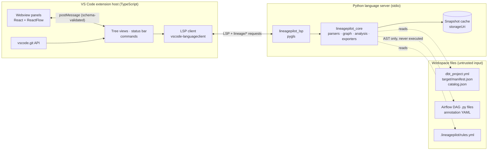

# VS Code Extension Design

**Status**: Direction approved 1 November 2026 (decisions D-1, D-3 and D-4 in section 15). Engineering details may still change at gate G0.
**Date**: 1 November 2026
**Name**: LineagePilot, chosen 1 November 2026. On that date nothing used the name on the VS Code Marketplace or Open VSX, and `lineagepilot`, `lineagepilot-core` and `lineagepilot-lsp` were free on PyPI. A trademark search is still needed before the public release.
**Companion**: [implementation_plan.md](implementation_plan.md)

---

## 1. Summary

Data Capsule is currently a hosted metadata server. This design turns it into a local VS Code extension that answers one question in the place where the change is made:

> If I change this dbt model or column, what breaks across downstream models, exposures and Airflow tasks, and how sure are we?

For the MVP, the extension reads only the dbt artifacts already in the workspace. It needs no server, no database and no credentials. It runs the existing Python parsers in a local language server and shows impact in five places:

- CodeLens
- Hovers
- The Problems panel
- A lineage graph
- A change-impact review that can be pasted into a pull request

**Reused**:
- The dbt, SQL and annotation parsers (about 2,800 lines, already independent of the database).
- The conformance rules that apply to dbt.
- The PII heuristics.
- The graph exporters.
- The ReactFlow lineage components (about 2,300 lines).

**Retired**:
- The FastAPI server, PostgreSQL schema, Next.js app, API-key authentication and BFF proxy.
- The CRUD-only entities (contracts, policies, SLAs, products, glossary).

---

## 2. Positioning

### What already exists (checked 1 November 2026)

| Tool | What it covers | Gap relevant to us |
|---|---|---|
| dbt Labs official VS Code extension [S1, S2] | Free. Model lineage. Requires the Fusion engine. Column lineage is marketed, but the official supported-features table lists it as "coming soon". | dbt only. No orchestration awareness. Fusion only. |
| dbt Power User (Altimate) [S3] | Model and column lineage, project health checks. Works with dbt Core. | dbt only. No dedicated change-impact review. |
| Altimate Code Actions, Atlan dbt action [S4] | Impact of dbt changes posted to pull requests. | GitHub Actions, not in the editor. dbt only. Atlan's action needs an Atlan instance. |
| Cartographer CLI [S5] | Maps a diff to dbt models and Airflow tasks. | A CLI with an MCP server, not an editor extension. Early version (0.9). |
| Airflow VS Code extension [S6] | Triggers DAGs, views logs. | No dbt or lineage awareness. |

### Implication

dbt-only lineage in the editor is **table stakes, not a differentiator**. We build it because users expect it, but the product wins only on three things that, as far as the search found, no single extension does together:

1. **Impact across tools.** Show which Airflow DAGs and tasks orchestrate or consume a dbt model, alongside its downstream models and exposures.
2. **A change-impact review of the working diff.** It shows explicit evidence and explicit unknowns, and can be exported to the pull request.
3. **Works on dbt Core artifacts, offline**, with no SaaS account.

Architecture conformance and PII indicators are supporting features, surfaced as diagnostics.

**Main competitive risk:** dbt Labs or Astronomer (who make Cosmos) adding Airflow awareness. The plan therefore validates the cross-tool wedge with users at gate G0, before the expensive phases.

---

## 3. Goals and non-goals

### MVP goals

| # | Goal |
|---|---|
| G1 | Index a dbt project from `target/manifest.json` and `catalog.json`, in both trusted and restricted workspaces. |
| G2 | Model- and column-level lineage through CodeLens, hover, a tree view and a graph webview. |
| G3 | A change-impact review of the branch and working-tree diff, with evidence classes and Markdown export. |
| G4 | Link dbt nodes to Airflow tasks by statically analysing DAG files in the workspace and by reading annotation files. |
| G5 | Conformance and PII indicators as diagnostics, using five result states (section 5.3). |
| G6 | Run in VS Code, Cursor, Windsurf and VSCodium, published to both the Marketplace and Open VSX. |

### Non-goals for the MVP

- A multi-user server, authentication or tenancy.
- Warehouse connections, including Snowflake.
- Live Airflow REST (post-MVP option).
- Catalog, glossary, contracts, policies, SLAs, data products, redundancy "savings" and impact-simulation percentages. The commercial review flagged the last two as unmeasured heuristics (F13).
- Editing dbt files, beyond trivial quick fixes after the MVP.
- AI features and BI connectors.

---

## 4. Architecture



**Process model**: one language server per workspace folder that contains a `dbt_project.yml`, which supports multi-root workspaces. The transport is **stdio only**: the extension never opens a network port.

### 4.1 Components

| Component | Language | Responsibility |
|---|---|---|
| `extension/` | TypeScript | Activation, interpreter discovery, language-server lifecycle, commands, tree views, status bar, git integration, webview host. After the MVP, also connector secrets in SecretStorage. |
| `extension/webview/` | React | Lineage graph, column lineage and the change-impact review panel. Built from the existing ReactFlow components. |
| `packages/lsp` (`lineagepilot_lsp`) | Python (pygls) | Standard LSP features (CodeLens, hover, diagnostics), plus the custom `lineage/*` requests. |
| `packages/core` (`lineagepilot_core`) | Python | Parsers, `MetadataGraph`, analysis (lineage, impact, rules, PII) and exporters. Editor-agnostic and headless, so it can also run in CI. |

### 4.2 Decision D-2: why a Python language server

| Option | For | Against |
|---|---|---|
| **A. Python LSP sidecar (recommended)** | Reuses the parsers and sqlglot. LSP gives diagnostics, hover and CodeLens natively. The same server can serve Neovim and JetBrains (via LSP4IJ) later. dbt Core and Airflow users already have Python. | Needs Python 3.10 or later. Two languages to maintain. |
| B. TypeScript rewrite | No Python dependency. | No TypeScript SQL parser comes close to sqlglot's dialect coverage. Means rewriting about 5,000 lines of parsing, at roughly 2–3× the effort. |
| C. Embed the FastAPI server on localhost | Maximum reuse. | Drags in PostgreSQL and SQLAlchemy. A local HTTP port reintroduces the DNS-rebinding and CSRF class of problems the BFF proxy had. Heavy dependencies. |
| D. Thin client to a hosted server | Smallest extension. | Keeps all the server's security and operations debt. Contradicts the reason for the pivot. |

**Risk for option A**: users who run only dbt Fusion may not have Python installed. Mitigation:
- Offer a uv-managed interpreter (downloaded only with the user's consent).
- Keep the core behind a stable JSON protocol, so the hot path could later be ported without changing the extension.

### 4.3 Decision D-2a: storage

The core keeps an in-memory `MetadataGraph`, rebuilt from the artifacts. It is snapshotted to `context.storageUri` using stdlib `sqlite3` or JSON, keyed by the manifest hash. The snapshots serve two purposes: fast warm starts, and stored baselines for change review.

There is no PostgreSQL and no ORM. With a single user, the artifacts are the source of truth. Removing the ORM also removes the field-name drift behind the review's findings F05 (obsolete `ColumnLineage` fields) and F06 (a row dictionary passed where a URN was expected).

### 4.4 Decision D-2b: packaging the Python side

Bundle **pure-Python** dependencies into `bundled/libs` with:

```
pip install --target bundled/libs --implementation py --only-binary=:all: --no-deps --require-hashes -r requirements.lock
```

This is the pattern Microsoft's Python tools extension template uses [S7], and it gives a single universal VSIX with no per-platform builds.

Spike S1 found that the template's command is not enough. Without `--only-binary=:all:`, pip silently builds sdists: PyYAML came out macOS-only, with a native `_yaml.so` in a "universal" bundle. The bundler (`scripts/bundle_libs.py`, from S1) therefore does four more things:
- It builds PyYAML, which has no pure wheel, from its hash-pinned sdist, with `PYYAML_FORCE_LIBYAML=0` and no build isolation. The only build dependency is a hash-pinned setuptools.
- It installs every locked package regardless of environment markers. That way, Python 3.10 backports such as `exceptiongroup` are present whichever Python builds the bundle.
- It fails the build on any compiled file or non-`py3-none-any` wheel tag.
- It writes `BUNDLE.json`, listing versions and hashes.

The packaged VSIX is checked again before release.

| Kept at runtime | Dropped |
|---|---|
| `sqlglot`; `pygls` with `lsprotocol`, `cattrs` and `attrs` (plus `typing_extensions` and `exceptiongroup`); `PyYAML` as a pure-Python build; `orjson` only if it is already importable (stdlib `json` otherwise) | fastapi, uvicorn, sqlalchemy, asyncpg, alembic, pydantic, httpx, snowflake-connector, typer, rich, structlog, prometheus, opentelemetry |

S1 measured the result: 8 packages, a 1.36 MB VSIX, and 0 compiled files. Startup to the first CodeLens takes about 0.45 s cold and 0.23 s warm.

**Launch**: the server runs as `python -I bundled/tool/lsp_server.py`, with the extension's directory as its working directory, and puts `bundled/libs` first on `sys.path`. Isolated mode keeps a workspace `yaml.py`, the user site-packages and `PYTHON*` variables from shadowing the bundle.

**Interpreter resolution, in order**:
1. The `lineagePilot.python.interpreterPath` setting. It is machine-scoped, so a workspace cannot set it (section 10). If it is set but unusable, that is an error, not a silent fallback.
2. The active environment from the Python extension, via `@vscode/python-extension`.
3. `python3` on `PATH` (on Windows, `py -3` and then `python`). On macOS, VS Code takes `PATH` from the login shell.
4. A uv-managed interpreter, offered with consent.

In an untrusted workspace, a candidate inside a workspace folder is never run, not even to probe its version (section 10).

Minimum Python version: 3.10.

---

## 5. Core data model

### 5.1 Identity

This answers the review's F09: today, URNs from different sources do not reconcile.

| Node kind | ID |
|---|---|
| dbt node (model, source, seed, snapshot, exposure) | Logical: the dbt `unique_id`, for example `model.shop.orders` |
| Physical relation | Normalised `database.schema.identifier`, taken from `relation_name` |
| Column | `<node id>#<column name>`, normalised to the adapter's case rules |
| Airflow DAG / task | `airflow:<dag_id>` / `airflow:<dag_id>.<task_id>`, plus the file path |

Logical-to-physical mappings are stored as explicit edges, so a dbt model and the warehouse table it builds stay connected without colliding.

### 5.2 Edges and evidence

| Edge | Meaning |
|---|---|
| `depends_on` | dbt node → dbt node (from the manifest) |
| `derives` | column → column, with a transformation type |
| `materialises` | logical node → physical relation |
| `orchestrates` | Airflow task → dbt node(s) |
| `task_depends_on` | Airflow task → Airflow task |

Every edge and every finding carries an evidence record:

| Field | Values |
|---|---|
| `origin` | `manifest`, `compiled_sql`, `catalog`, `dag_static`, `annotation` |
| `confidence` | `declared` (the artifact states it), `inferred` (derived by parsing), `heuristic` (pattern-based) |
| `artifact_version` | Manifest `generated_at`, `dbt_version` and the hash of the source file |
| `location` | File and range, used for navigation |

**Unresolved references are first-class records**, shown to the user and never silently dropped. The review's F07 found output columns being dropped this way, with only a debug log line.

### 5.3 Rule results

Every rule produces one of five results: `pass`, `fail`, `not_applicable`, `unsupported` or `unknown`.

- The score denominator **excludes** `unsupported` and `unknown`.
- Coverage is always shown next to the score.

This fixes the review's F11 (unsupported checks counted as passes). Rule packs live in a workspace file, `.lineagepilot/rules.yml`, so custom rules persist by construction. That fixes F10 (custom rules lost after the request that created them).

---

## 6. Data sources

### 6.1 dbt (MVP)

- **Discovery**: find projects by `dbt_project.yml`. Read `target/manifest.json`, `catalog.json` if present, and compiled SQL from the manifest's `compiled_code` or `target/compiled/`.
- **Staleness**: if a model file is newer than the manifest, the status bar warns.
- **Refresh**: the "Refresh dbt artifacts" command runs `dbt parse` or `dbt compile`. It is available in **trusted workspaces only** and always uses a user-configured executable, never a workspace-configured one.
- **Column lineage**: `sqlglot.lineage` over compiled SQL, using the dialect from `adapter_type` and a schema built from `catalog.json`. Spike S2 found that the existing `sql_column_parser` returns a single `*` for 86–100% of compiled dbt models, so it is not reused. `sqlglot.lineage` with a catalog schema resolved 91–99% of columns, in at most 0.35 s per model. A model that cannot be parsed, or that has no catalog, shows as `unknown`, not as having no lineage.
- **Versions**: manifest schema **v12** is supported. Spike S2 found that dbt Core 1.8, 1.9, 1.10, 1.11 and 1.12 and Fusion 2.0.9 all write v12. The check uses `metadata.dbt_schema_version`, never `dbt_version`, because Fusion reports `dbt_version` 2.0.x.
  - A newer schema version gets a warning, a best-effort parse and structural checks; if the checks fail, the index is marked `unknown`.
  - An older one gets a warning that it is untested.
  - Fusion is stricter about YAML and omits some keys, such as column `data_type`, but none that the parser reads.

### 6.2 Airflow (MVP: static analysis)

DAG files are parsed with Python's `ast` module. **They are never imported or executed.** The scanner detects:

- Astronomer Cosmos `DbtDag` and `DbtTaskGroup`: the project path and select/exclude arguments.
- `BashOperator` and `KubernetesPodOperator` commands that invoke `dbt run`, `dbt build` or `dbt test --select ...`.
- SQL operators with literal SQL, resolved to table references with sqlglot.
- Task dependencies from `>>`, `<<`, `set_upstream`, `set_downstream` and `chain()`, where the operands resolve to known tasks.

Dynamic DAGs (loops, factories, templated selectors) produce `unknown` records rather than guesses.

**What spike S3 changed** (1 November 2026). Literal operands alone are not enough: a scanner limited to literals missed 19 of 84 links (22.6%) on the three sample repositories. The scanner therefore also resolves, still with the AST only:
- constants imported from other workspace modules;
- `Path(__file__)` arithmetic, and environment-variable defaults (confidence `heuristic`);
- one level of inlining for local helper functions called with literals;
- the working directory of a `BashOperator` (`cwd`).

Remapping container paths was the largest single fix, recovering 15 of the 84 links. It works two ways:
- `/usr/local/airflow`-style paths are matched to workspace folders by suffix, as `heuristic`.
- An explicit path map goes in the annotation file.

Other rules from S3:
- **Heuristic is the normal confidence.** 71 of the 75 correct links were `heuristic`, so the review shows heuristic links by default, labelled as such.
- **Cosmos links come from the manifest.** A Cosmos link is stored once, at group level. Its per-model task ids are derived from the manifest, including which models have tests. The mapping is pinned to a Cosmos version range, and the S3 README documents it.
- **dbt-loom external nodes are excluded.** They have no file, and linking them gives false positives.
- **Selector semantics follow the manifest's dbt version.** dbt 1.10 changed wildcard matching. A `dbt ls` conformance test runs in CI.
- **File discovery matches Airflow's.** That means the safe-mode heuristic, `.airflowignore`, and skipping dbt project folders.
- **Unknowns are named.** The categories: remote manifest (`s3://`, `gs://`, `abfs://`), tasks generated from `manifest.json` at parse time, wrapper class, loop or factory, generated project, unsupported selector, Jinja, and a DAG that cannot load. Each is reported at the call site.

S3's evidence is in-sample: the scanner was built while reading the same repositories. A held-out corpus of 10 or more repositories, labelled before tuning, is the Phase 5 exit test (beads LP-56q.5).

**Reused**: `data_flow_annotations.py` (YAML mappings for anything the scanner cannot see) and `dbt_manifest_resolver.py`. **New**: `dag_static.py`.

**After the MVP**: live Airflow through the existing REST parser, with connection settings that a workspace cannot override and tokens in SecretStorage (section 10).

### 6.3 Warehouses

Post-MVP. If the Snowflake parser returns, its SQL construction must be fixed first: bind parameters for values, quoted identifiers for names, and no caller-chosen role (beads DCS-x9w).

---

## 7. User experience

| Surface | Behaviour |
|---|---|
| Activation | `workspaceContains:**/dbt_project.yml`, or on command. |
| CodeLens (model SQL, `schema.yml`) | `↓ 14 models · 3 Airflow tasks · 1 exposure · PII`. Clicking opens the impact view for that node. |
| Hover on `ref()` / `source()` and on select-list columns | Upstream and downstream summary, with the evidence class for each edge. |
| Sidebar tree views | **Lineage** (upstream and downstream of the active file) and **Airflow** (the DAGs and tasks touching it). |
| Lineage graph webview | Model and column modes, a depth control and filters. Clicking a node opens its file. |
| Problems panel | Conformance and PII diagnostics on model and `schema.yml` files, each with its rule ID, mapped severity and a docs link. |
| **Change Impact Review** panel | Base ref picker, defaulting to the merge-base with the default branch. Shows changed nodes and columns, then downstream impact grouped by dbt models, exposures, Airflow tasks and owners, then an **Unknowns** section. Has a "Copy as Markdown" action for the pull request. |
| Status bar | `Lineage: 1,204 nodes · manifest 3 min old`, or a stale-artifact warning. |
| Commands | Show lineage · Analyze impact of current model · Review changes · Refresh artifacts · Export graph (JSON / Mermaid / DOT / GraphML / Cypher) · PII inventory (Markdown / CSV). |

Navigation features that competitors already have (go-to-definition for `ref()`, model previews) stay out of the MVP. They would be added only if beta users ask, since they do not differentiate the product.

---

## 8. Change-impact review: algorithm

1. **Changed files**: diff from the merge-base with the default branch to the working tree, including untracked files, using the VS Code git API.
2. **Files to nodes**: map changed files to nodes using the manifest's `original_file_path` and `patch_path` (for `schema.yml`).
3. **Column changes**: compare each changed node's current output columns, from compiled SQL, with a baseline. Baselines in priority order:
   1. A baseline manifest from `lineagePilot.baseline.manifestPath` (typically the production manifest used for `--state`).
   2. Columns from `catalog.json`, which reflect what is actually deployed.
   3. Model level only, with every column marked `unknown`.
4. **Traverse downstream** on the current graph: use column edges where they exist, and fall back to model-level edges marked `inferred`.
5. **Cross into Airflow** through the `orchestrates` edges. Group the results by DAG, and take owners from `meta.owner` or `group`.
6. **Emit a structured result** as JSON, rendered as Markdown. A headless CLI entry point (`lineagepilot review`) produces the identical output for CI.

The output is deterministic: the same inputs always give the same review, with stable sorting and IDs, so reviews can be compared across pull requests.

---

## 9. Protocols

### Language server ↔ extension

Standard LSP, plus versioned custom requests (`protocolVersion` is negotiated at initialise):

| Method | Parameters | Returns |
|---|---|---|
| `lineage/status` | none | Node and edge counts, artifact ages, unresolved count |
| `lineage/graph` | `root`, `direction`, `depth` (capped), `granularity` | Nodes, edges, evidence |
| `lineage/impact` | `targets[]` | Grouped impact with unknowns |
| `lineage/reviewChanges` | `changedFiles[]`, `baseline` | A review result (section 8) |
| `lineage/export` | `format`, `scope` | Text content |
| `lineage/refresh` | none | Status |
| `lineage/indexUpdated` (notification) | Status | none |

Both sides validate every message against one shared JSON Schema: zod in TypeScript, and dataclass validators in Python.

Every request carries a `params` object, even an empty one. Spike S1 found that vscode-languageclient omits `params` when none are given. pygls 2.1 then fails to decode the request and never replies, so the call hangs.

### Webview ↔ extension

`postMessage` with a typed, zod-validated message union. The webview never talks to the language server directly, and file navigation goes through an `openFile` message that the extension handles.

---

## 10. Security model

**Threat model**: the main untrusted input is **the workspace itself**. A cloned repository can contain a crafted manifest, SQL, DAG files, rule packs and `.vscode/settings.json`. The hosted server's network attack surface disappears with this design; the workspace becomes the attack surface instead.

| Control | Design |
|---|---|
| Workspace Trust | `capabilities.untrustedWorkspaces.supported = "limited"`. Restricted mode only reads and parses artifacts: no dbt execution, built-in rules only. The interpreter and dbt-executable settings are listed in `restrictedConfigurations`. |
| Workspace interpreters | A cloned repository can commit a `.venv`, and the Python extension may select it. In an untrusted workspace, the extension never runs an interpreter inside a workspace folder, not even to probe its version. It checks the candidate path before probing and the resolved `sys.executable` after. |
| Setting scopes | Interpreter path, dbt executable and any future connection URL are **`machine`-scoped**, so workspace settings cannot set them. This closes the class of the server's Airflow `base_url` credential exfiltration (DCS-99m), where whoever chose the URL received the credential. |
| Secrets (post-MVP connectors) | Held only in VS Code SecretStorage, never in settings or environment variables. Each secret is bound to the host it was entered for. |
| Network | No listener, stdio only. No outbound network in the MVP. Telemetry is off; if it is ever added, it must respect `vscode.env.isTelemetryEnabled`. |
| Code execution | DAG files are analysed with the AST only; user Python is never imported. dbt runs only on an explicit user command in a trusted workspace. |
| Resource limits | Manifest size cap (configurable). Parsing runs in a worker with a per-statement time budget for sqlglot. Rule-pack regexes have a length cap and are evaluated with a timeout, or with `re2` if available. This closes the ReDoS class (DCS-61r). |
| Webview | CSP of `default-src 'none'; script-src 'nonce-…'; style-src ${webview.cspSource} 'unsafe-inline'; img-src ${webview.cspSource} data:`. `localResourceRoots` is limited to the bundled webview build. No remote resources. React rendering only, no `innerHTML`. |
| Exporters | Escaping for each format is fixed **before** export ships: Cypher uses parameters or JSON escaping; XML escapes every field; DOT uses quoted, escaped IDs; Mermaid uses generated IDs; CSV neutralises leading formula characters. This closes LP-auw, LP-aml and LP-l1s. |
| Supply chain | `package-lock.json` and `uv.lock` with hashes; bundled libraries installed with `--require-hashes`; `npm audit`, `pip-audit` and gitleaks in CI; the publisher account protected with 2FA; publishing only from CI. |
| Carry-over | **The leaked Snowflake key must still be rotated (DCS-hov).** Pivoting does not retract a key that is already public. |

---

## 11. Performance budgets

Spike S2 measured these on 1 November 2026, on an Apple M4 Max with native arm64 CPython. Each "measured" cell shows the worst of Python 3.10 and 3.13. "Fixed" means the parser with its per-column lineage loop replaced by a dictionary lookup (beads LP-58r.2).

| Operation | Budget | Measured, 5,000 models |
|---|---|---|
| Cold index, 2,000-model manifest | ≤ 5 s | 3.07 s as-is; 0.89 s fixed |
| Cold index, 5,000 models (reference) | none set | 16.5 s as-is (misses even the 2,000-model budget); 2.16 s fixed |
| Warm start from snapshot | ≤ 1 s | 0.18 s from JSON; SQLite is slower (0.22 s) |
| CodeLens and hover | ≤ 100 ms p95 | under 0.01 ms (lookup only) |
| Model-level impact | ≤ 300 ms | 0.38 ms; 3–5 ms from the source with the largest closure (651 nodes) in `lineagepilot_core`, and 16–25 ms for all 14 columns of that source at column level (task 1.4) |
| Column lineage for one model | ≤ 2 s | ≤ 0.35 s with `sqlglot.lineage` (section 6.1); 3 ms median in `lineagepilot_core` (task 1.9) |
| Graph webview | 500 nodes stay interactive | Phase 3 |
| Language server memory, 5,000 models | ≤ 500 MB RSS | 106 MB for a server that loads the snapshot. The indexer peaks at 0.66–1.06 GB in a separate child process. |

**Column lineage for every model is too slow for the cold index**: 8.2 s at 2,000 models and 20.5 s at 5,000 on Python 3.13, 28.6 s at 5,000 on 3.10 (task 1.9, including adding the edges). So the indexer publishes the model-level graph first and adds column lineage after it, model by model; a query that needs a model's columns before then computes that model on demand.

**The server freezes its heap once the graph is loaded** (`gc.collect(); gc.freeze()`). Without that, Python 3.10's full garbage collections over a 5,000-model graph paused impact queries for 200–285 ms, near the 300 ms budget; with it the worst query took 4.4 ms (task 1.4).

So **indexing runs in a child process**, never on the server's event loop: an `await`ed parse stalls the loop for about 2 s at 5,000 models, and a thread still leaves stalls of 100–520 ms. The server loads the indexer's snapshot. dbt itself takes 40–54 s (Core) or about 12 s (Fusion) to parse 5,000 models, so "Refresh dbt artifacts" runs asynchronously, with progress.

---

## 12. Reuse map

The modules below live in the data-capsule repository, under `backend/src/` and `frontend/`. Ported code is copied into this repository, never imported from there.

### Backend

| Current module | Fate |
|---|---|
| `parsers/base.py`, `dbt_parser.py`, `dbt_config.py`, `sql_parser.py`, `data_flow_annotations.py`, `dbt_manifest_resolver.py` | **Move** to `lineagepilot_core` and **fix what spike S2 found** (beads LP-58r.2). Stdlib `json` becomes the fallback for `orjson`. The fixes: <br>• Replace the per-column lineage loop, which costs O(columns × nodes). <br>• Derive `has_tests` from `test.*` nodes; it is always False on real manifests today. <br>• Parse exposures. <br>• Keep source file paths and `patch_path`. <br>• Key nodes by `unique_id`, because versioned models collide today. <br>• Gate on the schema version. <br>• Remove the `print()` that would corrupt the LSP channel. |
| `parsers/sql_column_parser.py` | **Replace** with `sqlglot.lineage` plus a catalog schema (section 6.1, beads LP-58r.8). |
| `parsers/airflow_parser.py`, `airflow_config.py` (REST) | **Keep** for live mode after the MVP. Their configuration is reworked per section 10. |
| `parsers/snowflake_*` | **Park** until after the MVP; fix the SQL construction first. |
| `services/conformance.py` | **Port** the 12 dbt-native rules and remap 6 more (below) onto a graph protocol with five result states. **Drop** the 42 rules that depend on entities which exist only in the server. |
| `services/compliance.py` | **Port** PII detection and tracing as *indicators*, tracing **all** upstream paths rather than the first one (review F12). |
| `services/lineage.py`, `task_impact.py` | **Rewrite** over the in-memory graph. They are small, and the rewrite fixes F06 by construction. |
| `services/graph_export.py` | **Port**, with the escaping fixes from section 10. |
| `services/impact_simulation.py`, `redundancy.py`, `slo.py`, `temporal_impact.py` | **Drop.** They rest on unmeasured heuristics (review F13). |
| `models/`, `repositories/`, `alembic/`, `api/`, `database.py`, `cache.py`, `rate_limit.py`, `metrics.py`, `tracing.py`, `cli/` | **Retire.** The CLI is replaced by the core's headless entry point. |

### Conformance rules

- **Carried as-is (12)**: the five medallion rules (MED_001–005), four dbt rules (DBT_001–004) and three PII rules (PII_001–003).
- **Remapped to dbt equivalents (6)**:

  | Server rule | dbt equivalent |
  |---|---|
  | "Tables should have primary key" | `unique` + `not_null` tests on one column, or a contract primary-key constraint |
  | "Primary keys should have uniqueness rules" | A `unique` test |
  | "Foreign keys should have referential integrity rules" | A `relationships` test |
  | "Gold tables should have quality rules" | Has dbt tests |
  | "Tables should have ownership" | `meta.owner` or `group` |
  | "Tables should belong to domain" | `meta.domain` |

### Frontend

| Current component | Fate |
|---|---|
| `CapsuleNode`, `ColumnNode`, `LineageGraph`, `ColumnLineageGraph`, `ColumnDetailPanel`, `ImpactAnalysis`, `SettingsPanel`, `TaskImpactGraph`, `TaskImpactList`, `TaskImpactSummary` (about 2,300 lines) | **Port** to the webview. The `@/lib/api/*` hooks are replaced by a message transport, and `next/navigation` by `openFile` messages. |
| Every other Next.js page and component | **Retire.** |

---

## 13. Repository layout

LineagePilot has its own repository. It moved out of data-capsule, with its history, on 1 November 2026.

```
spikes/          Phase 0 spikes S1–S3 (throwaway code and their reports)
packages/core/   lineagepilot_core   (pyproject.toml, uv.lock)
packages/lsp/    lineagepilot_lsp    (pygls server)
extension/       VS Code extension (package.json, src/, webview/, scripts/bundle_libs.py)
docs/            this design and the implementation plan
```

The legacy server and dashboard stay frozen in the data-capsule repository, in `backend/` and `frontend/`. Phase 1 copies the reused parsers from there (section 12). Nothing here depends on that repository at runtime or in CI. An `import-linter` contract stops `lineagepilot_core` from importing `sqlalchemy`, `fastapi` or `pydantic`.

---

## 14. Testing strategy

| Layer | Tooling | Gate |
|---|---|---|
| Core | pytest; golden fixtures (a small shop-style dbt project, a project with Cosmos DAGs, a synthetic 5,000-model manifest); hypothesis property tests on every exporter, checking that output re-parses and is injection-free | ≥ 80% coverage |
| Language server | pytest-lsp, end to end over stdio | All features covered |
| Extension | vitest units; `@vscode/test-cli` integration tests on the fixture workspace (CodeLens counts, diagnostics, commands, restricted-mode refusals) | ≥ 75% coverage |
| Webview | vitest with React Testing Library; message-schema contract tests shared with the extension | ≥ 75% coverage |
| CI matrix | ubuntu, macOS and Windows × Python 3.10 and 3.13. Package the VSIX and check a size budget. `npm audit`, `pip-audit`, gitleaks | Required for merge |

**Acceptance scenario**, adapted from the commercial review. The fixture is a source, a staging model, a mart, an exposure, and a Cosmos DAG task that consumes the mart. Rename a mart column, then confirm that:

- The review lists the affected downstream models, the exposure, the Airflow task and its owner.
- A deliberately unparseable model appears under **Unknowns**.
- Restricted mode still shows lineage but refuses to run dbt.

---

## 15. Decisions

### Decided (1 November 2026)

| # | Decision | Consequences |
|---|---|---|
| D-1 | **Retire the hosted server.** | Server-only beads issues closed as won't-fix: DCS-bjo, DCS-99m, DCS-cez, DCS-12y, DCS-sv1, DCS-l9p, DCS-9iq. Folded into plan tasks: DCS-ko1 (lockfile → 1.1) and DCS-61r (safe regexes → 1.5). Moved under Phase 1 as the exporter work (task 1.7): LP-auw, LP-aml, LP-l1s. Deferred until a Snowflake connector returns: DCS-x9w. **Still urgent: DCS-hov (rotate the leaked key).** |
| D-3 | **Static Airflow analysis plus annotation files in the MVP.** | Section 6.2. This is the wedge. |
| D-4 | **Name: LineagePilot.** | Python packages `lineagepilot_core` and `lineagepilot_lsp`; CLI `lineagepilot`; settings prefix `lineagePilot.*`. Before the public release: run a trademark search, create the publisher ID, and keep "dbt" out of the name per dbt Labs' trademark guidelines. |

### Open

| # | Decision | Recommendation |
|---|---|---|
| D-2 | Python sidecar or TypeScript rewrite | **Python sidecar** (section 4.2). Spikes S1 and S2 confirm or overturn this at gate G0. |
| D-5 | Licence and business model | Decide before the public release. The headless core makes a paid CI or team tier possible without a hosted catalog. |
| D-6 | How far to support Fusion | Support Fusion manifests. Revisit Python-free operation if Fusion-only users are a large share of the beta. |

---

## 16. Risks

| Risk | Likelihood / impact | Mitigation |
|---|---|---|
| The official dbt extension adds cross-tool impact | Medium / High | Validate the wedge at G0, ship the review early, keep dbt Core support. |
| Fusion-only users have no Python | Medium / Medium | uv-managed interpreter with consent. A stable protocol keeps a later port possible. |
| Jinja-heavy models with no compiled SQL | High / Medium | Column lineage shows `unknown`; prompt the user to compile; state this coverage in the review. |
| Dynamic DAGs defeat static analysis | High / Medium | Annotation files, explicit unknowns, and the live REST mode after the MVP. |
| A dependency is not pure Python | Low / Medium | Spike S1. Replace it, make it optional, or fall back to platform-specific VSIXs. |
| Large graphs are slow in the webview | Medium / Low | Depth caps, clustering by layer, and lazy expansion. |

---

## Sources

- **[S1]** dbt Fusion supported features: <https://docs.getdbt.com/docs/fusion/supported-features>
- **[S2]** dbt VS Code extension: <https://www.getdbt.com/lp/vs-code-extension>
- **[S3]** dbt Power User: <https://github.com/AltimateAI/vscode-dbt-power-user>
- **[S4]** Altimate Code Actions: <https://github.com/AltimateAI/altimate-code-actions>
- **[S5]** Cartographer: <https://pypi.org/project/brownfield-cartographer/0.9.0/>
- **[S6]** Airflow VS Code extension: <https://github.com/necatiarslan/airflow-vscode-extension>
- **[S7]** Microsoft Python tools extension template: <https://github.com/microsoft/vscode-python-tools-extension-template>
- Commercial review: *Data Capsule Code & Commercial Review*, 1 November 2026, findings F05–F13.
