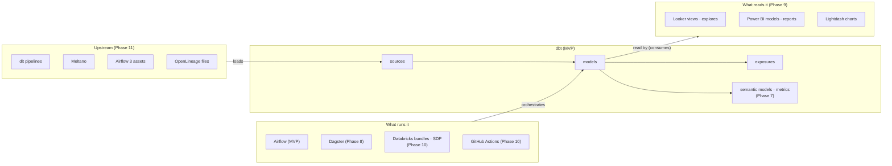

# LineagePilot after the MVP: beyond dbt and Airflow

**Status**: Proposal, 11 November 2026. Not approved. Nothing here starts before Gate G1 (LP-7er.4) decides to continue.
**Date**: 11 November 2026
**Builds on**: [design.md](design.md), in particular section 2 (Positioning), and [implementation_plan.md](implementation_plan.md), whose phases 0–6 this continues as phases 7–11.
**Tracking**: LP-7p9

---

## 1. Summary

The MVP answers one question for dbt and Airflow: if I change this model or column, what breaks, and how sure are we? This proposal widens "what breaks" to the other tools that dbt teams use most, in the order the evidence supports. It keeps what makes the MVP different: a review of the working diff, with evidence and unknowns, that runs offline and needs no account.

Proposed order, after Gate G1 and after the Airflow scanner's known gaps are closed:

| Phase | Adds | Why this, and why in this order |
|---|---|---|
| 7 | A multi-tool graph, and the dbt semantic layer | Every later phase needs the graph. Semantic models and metrics are already in the manifest, so they prove the consumer path without a new parser. |
| 8 | Dagster | The second orchestrator for dbt: `dagster-dbt` has 74% of the downloads of `astronomer-cosmos`. |
| 9 | BI: Looker (LookML), Power BI (PBIP/TMDL), Lightdash | "Which dashboard breaks" is the question dbt exposures answer worst. Looker and Power BI lead BI by spend and by share, and both now keep definitions as text in git. |
| 10 | Declarative orchestrators: Databricks Asset Bundles with Spark Declarative Pipelines, and GitHub Actions | dbt-databricks is the most downloaded adapter after dbt-snowflake, once adapters pulled in as another's dependency are set aside. Bundles and workflows keep jobs in YAML, which can be read exactly. |
| 11 | Upstream: dlt, Meltano, Airflow 3 assets, and OpenLineage files | Connects a dbt source to what loads it. OpenLineage is the general route for tools that will never get a reader of their own. |

Two rules shape the order:

- **Declarative first.** A tool whose definitions are YAML, LookML or TMDL files in the repository can be read exactly. A tool defined in Python can only be read as far as the AST allows. The held-out corpus showed how far that goes for Airflow: 17 of 106 links ([corpus/README.md](../corpus/README.md)).
- **No connections.** A tool that lives only in a SaaS service (Fivetran, Tableau Cloud, dbt Cloud jobs, warehouse query history) is read from an export file that the user makes with their own tools. LineagePilot never connects to it. Whether to ever add live connectors stays an open decision (D-12).

Not proposed: a second transformation framework (SQLMesh, Dataform), data-quality tools, Prefect, Tableau and Metabase. Section 6.9 says why, and what evidence would change that.

**Estimate**: about 16–22 weeks for one engineer, with held-out corpus labelling running in parallel. A new gate, G2, after Phase 9 decides whether to keep widening or to deepen what exists instead.

---

## 2. Where the MVP leaves us

### What carries forward

- **One graph per dbt project** (`MetadataGraph`), with an evidence record on every edge and unknowns kept as records of their own (design §5).
- **The Change Impact Review.** It maps changed files to nodes, compares columns with a baseline, traverses downstream, crosses into Airflow, and renders Markdown. The panel and `lineagepilot review` give identical output (design §8).
- **A pattern for reading another tool: the Airflow scanner.** It reads files as data in a child process with budgets and links them to the graph through a manifest. It never stores its result in a snapshot, and it names every unknown at the line that caused it (design §6.2). It is about 7,000 lines in `lineagepilot_core.airflow`, the best estimate available of what a reader for a Python-defined tool costs.

### What it taught

- **In-sample results flatter.** Spike S3's 0% miss rate became 84.0% on 17 unseen repositories. Each new reader therefore gets a held-out corpus, labelled before tuning, and its miss rate is reported alongside its hits.
- **Honest unknowns hold up.** The scanner was wrong on 2 of 106 links and made no false positives. That is what lets a reviewer trust it, and it is worth more than coverage.
- **Python definitions are the hard case.** 62 of the 89 misses came from general limits of reading Python without running it: environment variables, helpers in other files, and container paths.

### Code the generalisation touches

- `NodeKind` has `AIRFLOW_DAG` and `AIRFLOW_TASK`, and `Origin` has `DAG_STATIC` (`graph/model.py`).
- The protocol has `lineage/airflow`, and review results have an `airflow` field (`protocol/lineage-protocol.schema.json`).
- The dbt parser indexes only models, seeds, snapshots, sources and exposures (`INDEXED_PREFIXES` in `parsers/dbt_parser.py`). Metrics, semantic models and saved queries are known to the selector engine but are not graph nodes.

---

## 3. Positioning, revisited

Design section 2 (1 November 2026) concluded that dbt-only lineage in the editor is table stakes. The product wins only on three things together: impact across tools, a review of the working diff with evidence and unknowns, and dbt Core artifacts read offline. It named one main risk: dbt Labs or Astronomer adding Airflow awareness.

### 3.1 What changed in 2026

| When | Change | What it means here |
|---|---|---|
| 22 January | State of Airflow 2026: dbt is the tool most often paired with Airflow, used by 44% of more than 5,800 respondents. 26% have moved to Airflow 3 [N4]. | The MVP's pairing is still the largest. |
| 25 March | Fivetran gave SQLMesh to the Linux Foundation [N3]. | SQLMesh stays an independent open framework, but it is small next to dbt (section 4.6). |
| May | Fivetran agreed to become steward of the Great Expectations open-source project, and FICO agreed to buy GX Cloud [N2]. | The vendor that owns ingestion adds data quality. |
| 1 June | Fivetran and dbt Labs completed their merger. George Fraser is CEO and Tristan Handy is President [N1]. | One vendor now owns ingestion and transformation, and can ship lineage from connector to model inside its own products. |
| 2026 | Astro Observe shows lineage from dbt models through Airflow tasks to downstream consumers. It collects that lineage at run time with OpenLineage, on the Team tier and above, according to Astronomer's own pages [N8]. | The named risk has partly happened, for dbt and Airflow, as a hosted product that only sees runs. |
| 2026 | The dbt VS Code extension offers column lineage only with Fusion's strict static analysis [N6], and no orchestration awareness was found. dbt v2 writes a v12 manifest that dbt v1 can read [N7]. | The official extension is still dbt-only. The MVP's v12 gate still holds. |
| 2026 | Dagster shows column lineage for dbt only in Dagster+, and only after the assets have run [N9]. | Runtime, hosted, and Dagster-only. |
| 2026 | Recce compares a dbt branch with production data, and shows a lineage diff and the impact radius from dbt artifacts [N10]. | The closest product to the review, but dbt-only and built on comparing data. |

### 3.2 The three differentiators, tested again

| Differentiator (design §2) | Where it stands, November 2026 | What the next phase must do |
|---|---|---|
| 1. Impact across tools | Contested for dbt and Airflow by Astro Observe, which is hosted and sees only runs. Each vendor covers its own pair: Astronomer covers Airflow, Dagster+ covers Dagster, and Fivetran with dbt Labs covers its own stack. None shows a competitor's tools. | Widen to the tools beside dbt that no single vendor covers together. Neutrality between vendors is the position. |
| 2. A review of the working diff, with evidence and unknowns | Still uncontested before merge, in the editor. Runtime lineage only knows what has already run, so it cannot see a branch. | A tool is not done until it appears in the review, with evidence and unknowns. |
| 3. dbt Core artifacts, offline, with no account | Still uncontested: every cross-tool view found is hosted. | Read files in the repository. A tool that lives only in a service is read from an export file the user makes, never by connecting to it. |

### 3.3 Implication

The cross-tool wedge has to grow from "dbt and Airflow" to "dbt, whatever runs it, and whatever reads it". Reading the repository before merge is what the hosted runtime products cannot do, so the review stays at the centre. Each new tool is added as rows in the same review, never as a separate feature.

The main risk changes shape. The merged Fivetran and dbt Labs could put lineage from ingestion to dashboard into the dbt extension. LineagePilot's answer is the tools outside that stack (Airflow, Dagster, Databricks, Looker, Power BI) and the pull request, where the review lives.

---

## 4. Which tools: the popularity evidence

### 4.1 How it was measured

- **Downloads** cover the last 30 days to 11 November 2026, from pypistats.org for Python packages and from the npm registry API [N16]. Most downloads come from CI and containers, not people. A package that others depend on is inflated by them. So the strongest signal is an **integration package**: a team installs `dagster-dbt` only in order to run dbt with Dagster.
- **GitHub stars** were read the same day. They measure attention more than use.
- **Surveys**: State of Airflow 2026 [N4]. The dbt Labs State of Analytics Engineering 2026 had 363 responses and gives no figures on tools in its text [N5]. Published BI market shares disagree by method [N14], so they are used here for order only.
- **All of these are proxies.** What the beta teams actually run is better evidence (section 13, question 1).

### 4.2 Orchestration

| Signal | Airflow | Dagster | Prefect | Kestra | Databricks Jobs |
|---|---|---|---|---|---|
| Integration with dbt (downloads) | `astronomer-cosmos` 2,011,713; `apache-airflow-providers-dbt-cloud` 593,038 | `dagster-dbt` 1,488,825 | `prefect-dbt` 267,900 | none on PyPI (a plugin of the Java server) | `databricks-bundles` 864,985; the adapter `dbt-databricks` 3,741,376 |
| Base package (downloads) | `apache-airflow` 7,196,244 | `dagster` 7,886,605 | `prefect` 6,895,663 | `kestra` 11,290,483 (see below) | n/a |
| GitHub stars | 47,447 | 16,387 | 24,150 | 30,203 | n/a |
| Where definitions live | Python | Python, or YAML components | Python flows; deployments in YAML | YAML | YAML bundles, or Python |

How to read the table:

- **Airflow stays first.** 44% of Airflow users pair it with dbt [N4].
- **Dagster is a clear second for dbt.** `dagster-dbt` has 74% of the downloads of `astronomer-cosmos`.
- **Prefect is a distant third.** `prefect-dbt` has under a fifth of the downloads of `dagster-dbt`.
- **Databricks is a large dbt platform.** Asset Bundles keep its jobs in YAML.
- **Kestra gets attention but shows no dbt pairing.** Its `kestra` Python package is a small helper that Kestra's script tasks install, so its downloads probably count task runs rather than teams.
- **Base-package downloads are not comparable across tools.** Airflow 3 splits into `apache-airflow-core` (2,625,418) and `apache-airflow-task-sdk` (2,290,509). Each of Dagster's many integration packages installs `dagster`.
- **Luigi (723,660 downloads, 18,785 stars) and Mage (10,139 downloads) are not considered.** Neither shows a dbt integration signal.

### 4.3 Consumers: BI and the semantic layer

| Tool | Signal | Definitions in the repository? |
|---|---|---|
| Looker | `looker-sdk` 8,603,624; `lkml`, a LookML parser, 789,834. In Ramp's spend data (2025), Looker and Tableau lead BI spend, ahead of Power BI [N14]. | Yes, by design: views, explores and LookML dashboards live in git. Dashboards saved in the Looker instance do not. |
| Power BI | Leads most measures of share; web-usage trackers put it at 31.8% of sites against Tableau's 27.8% [N14]. TMDL is generally available, and so is the Power BI Project format (PBIP) according to one source [N13]. | Yes, when saved as a Power BI Project: the semantic model as TMDL text and the report as JSON. A `.pbix` file is binary. |
| Tableau | `tableauserverclient` 4,113,122; second in most share measures [N14] | Rarely. `.twb` and `.tds` XML can be committed, but workbooks usually live in Tableau Server or Cloud. |
| Lightdash | `@lightdash/cli` 280,186 (npm); 6,228 stars | Yes. It reads dbt YAML, and its charts and dashboards download as YAML. |
| Metabase | 50,281 stars | Only through serialization, a paid feature. Otherwise in its own database. |
| Superset | `apache-superset` 373,970; 75,479 stars | Only as exported YAML. |
| Cube | `@cubejs-backend/server-core` 297,137 (npm); 21,211 stars | Yes, as YAML or JavaScript models. |
| dbt semantic layer | `metricflow` 6,533,885 | Already in the manifest: semantic models, metrics and saved queries. |

How to read the table:

- **Looker and Power BI are the two first-tier BI tools.** Looker leads by spend among the companies most likely to run dbt. Power BI leads by overall share. Both now keep their definitions as text in git.
- **The order between them is a judgement.** Ramp's customers lean towards US start-ups, which favours Looker, and web-usage counts favour Power BI. The order is decided here on readability: LookML is a stable, documented format, while Power BI's report format (PBIR) was still described as a preview in the sources found [N13].

### 4.4 Upstream: ingestion

| Tool | Signal | Where definitions live |
|---|---|---|
| Fivetran | A Leader in the 2026 Gartner Magic Quadrant for data integration [N15], and now merged with dbt Labs. It has no package to count. | In the service, or optionally Terraform |
| dlt | `dlt` 4,923,870; `dagster-dlt` 309,507; 6,077 stars | Python in the repository |
| Singer and Meltano | `singer-sdk` 1,974,666; `meltano` 191,338 | `meltano.yml` in the repository |
| Airbyte | `airbyte-cdk` 541,275; `airbyte` (PyAirbyte) 482,342; `apache-airflow-providers-airbyte` 390,113; 22,358 stars | In the service, or optionally Terraform |
| Airflow 3 assets | 26% of Airflow users run Airflow 3 [N4] | `outlets=[Asset(...)]` in DAG files the scanner already reads |

dlt is the fastest-growing ingestion tool that lives in the repository. Its download volume is comparable to that of the major dbt adapters. Fivetran is the most widely used, and the least readable offline.

### 4.5 Warehouses (context)

dbt adapter downloads:

| Adapter | Downloads |
|---|---|
| `dbt-snowflake` | 5,423,658 |
| `dbt-spark` (installed by `dbt-databricks`) | 4,395,402 |
| `dbt-postgres` (installed by `dbt-redshift`, and used on its own) | 4,158,687 |
| `dbt-databricks` | 3,741,376 |
| `dbt-bigquery` | 3,609,571 |
| `dbt-duckdb` | 1,920,474 |
| `dbt-redshift` | 1,816,448 |
| `dbt-clickhouse` | 1,218,703 |
| `dbt-trino` | 591,852 |
| `dbt-athena-community` | 528,634 |
| `dbt-fabric` | 510,809 |
| `dbt-sqlserver` | 184,986 |

These figures decide two things. The new readers must resolve SQL dialects and table names for Snowflake, Databricks and BigQuery first. And Databricks earns an orchestrator of its own (Phase 10). Snowflake and Databricks are "neck and neck" among Airflow users [N4].

### 4.6 Other transformation frameworks

- **dbt**: `dbt-core` 22,528,136.
- **SQLMesh**: `sqlmesh` 452,428, which is 2% of `dbt-core`, and 3,348 stars. It has been a Linux Foundation project since March 2026 [N3].
- **Dataform**: `@dataform/core` 3,438,680 npm downloads, much of it probably Google Cloud compiling projects for its managed service, and 1,000 stars.
- **Spark Declarative Pipelines**: in Apache Spark since 4.1 as `pyspark.pipelines`. It is the open core of Databricks Lakeflow Declarative Pipelines, formerly Delta Live Tables [N12].

Supporting a second framework would mean building a second product: a new artifact model, a new review baseline and new column lineage. SQLMesh also has its own plan, which already classifies changes as breaking or not. Neither SQLMesh nor Dataform is proposed (section 6.9).

Spark Declarative Pipelines are different. They produce and read tables beside dbt in the same Databricks workspace, so they enter in Phase 10 as pipelines, not as a framework.

### 4.7 Data quality and lineage standards

- **Data quality**: `great-expectations` 19,160,330 (inflated by the platforms that depend on it); `soda-core` 1,750,937; `elementary-data` 891,127, a dbt package whose tests are already in the manifest; `recce` 32,179.
- **OpenLineage**: `openlineage-python` 4,569,798; `apache-airflow-providers-openlineage` 1,024,801; `openlineage-dbt` 190,213. Since version 1.0, OpenLineage has had static lineage events that need no run (JobEvent and DatasetEvent) [N11], and Astro Observe collects its lineage with OpenLineage [N8].

---

## 5. How tools are chosen

### 5.1 Readability classes

| Class | What it is | Examples | Expected quality |
|---|---|---|---|
| **A. Declarative files in the repository** | YAML, LookML, TMDL, SQL | Dagster components (`defs.yaml`), Databricks Asset Bundles, GitHub Actions workflows, Kestra flows, LookML, PBIP/TMDL, Lightdash YAML, `meltano.yml`, dbt semantic models | Exact where values are literal. Templating (Liquid, Jinja, parameters) becomes an unknown. |
| **B. Python in the repository** | Read with the AST, never run | Dagster `@dbt_assets`, Prefect flows, dlt pipelines, Spark Declarative Pipelines in Python | Like Airflow: correct when it can read the code, but often unknown. Needs a held-out corpus before any claim. |
| **C. Only in a service** | Needs credentials and a network connection | Fivetran connectors, Tableau Cloud, dashboards saved in a Looker instance, dbt Cloud jobs, warehouse query history | Never read by connecting. Read from an export file the user makes (section 6.8), or from an annotation. |

### 5.2 Scoring

Each tool is scored on four things:
- popularity with dbt teams (section 4);
- readability (section 5.1);
- review value: does it tell a reviewer something they would otherwise miss?
- cost: how much of what exists it can reuse.

| Tool | Popularity with dbt teams | Class | Review value | Reuses | Decision |
|---|---|---|---|---|---|
| dbt semantic layer | High (already in the manifest) | A | Medium: metrics and saved queries break when a column is renamed | Manifest parser, selector engine | Phase 7 |
| Dagster | High: the second orchestrator | A and B | High: the asset, job and schedule, and the non-dbt assets downstream | Selector engine, safe AST evaluator | Phase 8 |
| Looker | High | A | High, at column level: which dimensions, explores and LookML dashboards | sqlglot for derived tables | Phase 9 |
| Power BI | High overall; medium among dbt teams | A when saved as PBIP, otherwise C | High: which columns and report pages | sqlglot for native queries | Phase 9 |
| Lightdash | Medium, but every Lightdash user is a dbt user | A | Medium to high | dbt YAML | Phase 9 |
| Databricks Asset Bundles and Spark Declarative Pipelines | High: the second adapter | A, and B for Python | High for Databricks teams | The dbt command parser from Phase 5 | Phase 10 |
| GitHub Actions running dbt | Not measured; common in small teams | A | Medium | The dbt command parser | Phase 10 |
| dlt | High, and rising | B | Medium: upstream | Safe AST evaluator | Phase 11 |
| Meltano and Singer | Medium | A | Medium: upstream | YAML reading | Phase 11 |
| Airflow 3 assets | Rising (26% on Airflow 3) | B, in files already read | Medium: upstream | The DAG scanner | Phase 11 |
| OpenLineage files | Medium; the open standard | A (JSON) | Medium: covers tools that have no reader | none | Phase 11 |
| Prefect | Low to medium | B | Medium | Phase 8's Python reading | Deferred, by demand |
| Kestra | Not measured for dbt | A | Medium | The dbt command parser | Deferred, by demand (cheap) |
| Tableau, Metabase, Sigma, Hex | High (Tableau) to medium | Mostly C | High | none | Export-file route (section 6.8), by demand |
| Fivetran, Airbyte | High | C; A through Terraform | Medium: upstream | none | Export file or Terraform, by demand |
| Soda, Great Expectations | Medium | A (Soda YAML) or B | Medium | none | Deferred |
| SQLMesh, Dataform | Low among dbt teams; Dataform is Google Cloud only | A | none in the review (they replace dbt rather than sit beside it) | none | Not proposed |
| Warehouse query history | High value | C | The highest: who actually reads a table | The parked Snowflake parser | Export-file route. A live connection is decision D-12. |

---

## 6. The proposal

### 6.1 Order and estimates

| Phase | Focus | Estimate (one engineer) | Ends with |
|---|---|---|---|
| Entry | Close the Airflow gaps, and label a fresh corpus | Already in beads | The Airflow miss rate measured again (section 6.2) |
| 7 | A multi-tool graph, and the dbt semantic layer | 3–4 weeks | Airflow behaves as before through the new contract; the semantic layer is in the review |
| 8 | Dagster | 3–4 weeks | The acceptance scenario passes with Dagster; a held-out miss rate is reported |
| 9 | BI: Looker, Power BI, Lightdash | 4–6 weeks | The acceptance scenario passes with consumers; a held-out miss rate is reported per tool; **Gate G2** |
| 10 | Databricks Asset Bundles with Spark Declarative Pipelines; GitHub Actions | 3–4 weeks | The acceptance scenario passes with Databricks jobs |
| 11 | Upstream: dlt, Meltano, Airflow 3 assets; OpenLineage files | 3–4 weeks | A changed ingestion file is reviewed through to the dbt models below it |

That is 16–22 weeks in total. After Phase 7, phases 8–11 do not depend on each other, so what the beta teams run can reorder them. Labelling each phase's corpus runs in parallel, and finishes before that phase's tuning starts.

### 6.2 Entry conditions

1. **Gate G1 says continue** (LP-7er.4). If it says to pivot to a CI-only product instead, this plan still applies: everything here is in `lineagepilot_core` and reaches `lineagepilot review`.
2. **The three general Airflow gaps are closed**: LP-0o1, LP-z2x and LP-c05, which caused 62 of the 89 misses. The fresh corpus (LP-aax) then measures the result. Airflow is still the largest pairing, and widening on top of an 84% miss rate would spread a known weakness.
3. **Server memory is within its budget** (LP-dtt). Every reader adds to it.

### 6.3 Phase 7: a multi-tool graph, and the dbt semantic layer

| ID | Task |
|---|---|
| 7.1 | Generalise the graph model (section 7.1). Move the Airflow scanner onto it, keeping its tests unchanged as the evidence that nothing broke. |
| 7.2 | Define the reader contract (section 7.2), with Airflow as its first reader. Move the shared pieces out of `lineagepilot_core.airflow` (`safe_io`, `values`, `shell`, `selector`, `workspace`) into a shared package. |
| 7.3 | Generalise the annotation file (section 7.3). |
| 7.4 | Add `lineage/pipelines` and `lineage/consumers`, the new review sections and the new tree views (sections 7.4 and 7.5). |
| 7.5 | Index the dbt semantic layer from the manifest: semantic models, metrics and saved queries (with their exports) become consumer nodes. They get `consumes` edges to the model, and to the columns their measures, dimensions and entities name. A renamed column then lists the metrics that use it. |
| 7.6 | Generalise the corpus scorer in `corpus/` so it scores any reader's links. |

**Exit**:
- The Phase 5 acceptance scenario passes. Its golden files change only by the renames agreed in D-9.
- Renaming a mart column lists the metric and the saved query that use it.
- The §11 budgets of the design still hold.

### 6.4 Phase 8: Dagster

**What it reads**:
- **Components**: `defs.yaml` files with `type: dagster_dbt.DbtProjectComponent`, their `project` and their selection attributes [N9], and the `dg` project layout with `[tool.dg]` in `pyproject.toml`.
- **Python definitions**, read with the safe AST evaluator:
  - `@dbt_assets(manifest=..., select=..., exclude=...)` and `DbtProject(project_dir=...)`;
  - `define_asset_job(selection=...)` with `AssetSelection`, and schedules (`ScheduleDefinition`, `@schedule`);
  - non-dbt assets that depend on dbt assets: `@asset(deps=[...])`, `AssetIn` and `AssetSpec(deps=...)`.
- **Asset keys.** dagster-dbt derives an asset key from each dbt node. A team can override it with `meta.dagster.asset_key` or with a custom translator. The reader derives the same key. A custom `DagsterDbtTranslator` subclass is a named unknown. A CI conformance test compares the reader's keys with dagster-dbt's own on a fixture project, as `selector_conformance.py` does with `dbt ls`.

**What the review shows**: Dagster rows, grouped by code location and job. Each row gives the assets that materialise the changed models, the jobs and schedules that run them, and the non-dbt assets downstream, such as a feature table or an export.

**New unknown categories**:
- a custom translator;
- asset keys computed at run time;
- `@multi_asset` with computed specs;
- definitions built by a factory;
- assets loaded from modules outside the workspace;
- Dagster Pipes, which runs an external process.

Several of these fold into the existing categories (wrapper, loop or factory, not literal).

**Exit**:
- The acceptance scenario on `fixtures/impact-shop` passes with a Dagster component and a Python definitions file.
- A held-out corpus of 10 or more public Dagster and dbt repositories is labelled blind, and its miss rate is reported.

### 6.5 Phase 9: consumers in BI

#### Looker (LookML)

- **Files**: `.view.lkml`, `.model.lkml`, `.explore.lkml` and `.dashboard.lookml`, read with a bounded parser. `lkml` is pure Python and MIT-licensed; the bundler's checks (design §4.4) confirm whether it can ship, and if it cannot be bounded, LineagePilot writes its own parser.
- **A view's table**: from `sql_table_name`, or from `derived_table: sql:`, which sqlglot parses in the connection's dialect.
- **Fields**: `${TABLE}.column` in a field's `sql:` gives a `consumes` edge from the field to the model's column. Explores join views, and LookML dashboards name explore fields.
- **Structure**: `include:`, `extends` and refinements (`+view`) are resolved.
- **Templating**: Liquid (``) is an unknown. `@{constant}` is resolved where the constant is literal.
- **Matching a view to a dbt node**: by relation name (design §5.1), with the rules SQL operators use (design §6.2). A full name is `inferred`. A partial name is `heuristic`, and counts only if exactly one relation ends with it.
- **The boundary**: Looks and dashboards saved in the Looker instance cannot be seen offline. Every review that has Looker rows says so. A content export can cover them (section 6.8).

#### Power BI (Power BI Projects)

- **Semantic model** (`*.SemanticModel/definition/` TMDL files): tables, columns with their `sourceColumn`, and partitions written in Power Query M.
  - For the common connectors (`Snowflake.Databases`, `Databricks.Catalogs`, `GoogleBigQuery.Database`, `Sql.Database`), M navigation steps give the source table. M is never evaluated.
  - The text of `Value.NativeQuery` goes to sqlglot.
  - DAX references (`'Table'[Column]`) give edges within the model.
- **Report** (`*.Report/definition/` in PBIR, or the legacy `report.json`): which visuals, on which pages, use which fields.
- **Unknowns**: M built from parameters or functions, dataflows, models built on another model, and a `.pbix` file. A `.pbix` is binary, so the review says to save it as a Power BI Project to include it.

#### Lightdash

- Dimensions and metrics come from the dbt YAML that Lightdash reads (`meta` on models and columns), so its explores are the dbt models themselves.
- Charts and dashboards come from the YAML that `lightdash download` writes (charts as code).

#### Exposures

- When a BI reader finds a dashboard that a dbt exposure also names (matched by URL), the two become one row.
- An exposure whose dashboard has no file stays as it is.

**Exit**:
- The acceptance scenario passes with a LookML view and explore, a Power BI Project model and report, and a Lightdash chart, all on the mart. Renaming the mart column lists the dimension, the Power BI column and page, and the chart.
- A Liquid-templated view and a parameterised M query appear as unknowns.
- Each tool has a held-out corpus. Public LookML repositories are plentiful. Public Power BI Projects are fewer; if the sample is small, its size is reported with the result.
- Gate G2 (section 10).

### 6.6 Phase 10: declarative orchestrators

#### Databricks Asset Bundles

- **Files**: `databricks.yml` and the resource files it includes.
- **Jobs**: `resources.jobs.<job>.tasks[]`.
  - `dbt_task.commands` are dbt commands, read by the shell parser from Phase 5, with `project_directory` giving the project.
  - `depends_on` between tasks gives `task_depends_on` edges.
  - `pipeline_task` points at a Spark Declarative Pipeline.
  - `sql_task` is parsed with sqlglot. `notebook_task` is an unknown unless the notebook is SQL.
- **Variables**: `${var.x}` is resolved from the bundle's defaults and targets where literal. The default target is read, and the review names which target that was.

#### Spark Declarative Pipelines (Lakeflow)

- **SQL**: `CREATE MATERIALIZED VIEW` and `CREATE STREAMING TABLE … AS SELECT`, parsed with sqlglot in the Databricks dialect.
- **Python**: `@dp.table` and `@dlt.table` functions, with literal table reads, through the AST.
- **Place in the graph**: these pipelines produce tables that dbt reads as sources (upstream), or read tables that dbt builds (downstream).

#### GitHub Actions

- **Files**: `.github/workflows/*.yml`.
- **dbt steps**: a step whose `run:` invokes dbt. The shell parser reads it. `${{ }}` expressions are treated like Jinja, as unknowns.
- **Schedule**: `on.schedule` cron entries become the pipeline's schedule.

#### Candidates, if beta teams ask

- **Kestra flows**: `io.kestra.plugin.dbt.cli.DbtCLI` tasks, in YAML.
- **dbt Cloud jobs defined in Terraform**: `dbtcloud_job` and its `execute_steps`. These would answer a common Airflow unknown, `DbtCloudRunJobOperator` (`apache-airflow-providers-dbt-cloud` has 593,038 downloads).

### 6.7 Phase 11: upstream

- **dlt**: `dlt.pipeline(pipeline_name=..., destination=..., dataset_name=...)` and the `name` or `table_name` of its resources give the tables it loads. These are matched to dbt sources by schema and identifier, and linked with `loads` edges.
- **Meltano**: in `meltano.yml`, the extractors and their selected streams, and each loader's schema setting.
- **Airflow 3 assets**: `outlets=[Asset(...)]` and `inlets` on tasks that are already scanned, and Airflow 2's `Dataset` too. An asset that names a dbt source's table links the task upstream of that source.
- **OpenLineage files**: OpenLineage events read from a file. They can be run events, or the static job and dataset events [N11].
  - Jobs become pipeline and task nodes.
  - Inputs and outputs become relations by OpenLineage's dataset naming, mapped to dbt relations per platform.
  - The evidence origin is `openlineage`.
  - This is the route for Spark jobs, Flink, and any other tool that has an OpenLineage integration but no reader here.
- **What the review gains**:
  - For a changed source definition, it shows what loads that source.
  - For a changed dlt or Meltano file in the same repository, it shows the dbt models below that file and everything after them. That is a change upstream of dbt, which the MVP lists only as "other changed files".

### 6.8 The export-file route, for tools that live in a service

For a tool in class C:
1. LineagePilot documents a command or query that the user runs with their own credentials. Examples: a Looker content export from its API, a Tableau Metadata API query, a Snowflake `ACCESS_HISTORY` query, the dbt Cloud jobs API, the Fivetran connectors API.
2. The user saves the result as a file.
3. A machine-scoped setting, `lineagePilot.exports.<tool>`, points at the file.

LineagePilot reads the file as untrusted data, with the same caps as any other input. It never holds a credential and never opens a connection. The review states the export's date, so a stale export is visible.

The route is built per tool, by demand, after Phase 9. The first candidate is the Looker content export, which closes the gap left by dashboards saved in the Looker instance (section 6.5).

### 6.9 Considered and not proposed

| Tool | Why not now | What would change that |
|---|---|---|
| SQLMesh | 2% of `dbt-core`'s downloads. Its own plan already classifies breaking changes. A second framework is a second product. | Demand from beta or public users, or SQLMesh projects that consume dbt models. |
| Dataform | Google Cloud only, and the review would need a second artifact model. | Demand from Google Cloud teams. |
| Prefect | `prefect-dbt` has under a fifth of `dagster-dbt`'s downloads, and its definitions are Python only. | Demand. Phase 8's Python reading makes it cheaper. |
| Tableau, Metabase, Sigma, Hex | Their definitions live in the service. | The export-file route (section 6.8). |
| Fivetran, Airbyte | They live in the service, though Terraform files are possible. | An export or Terraform reader, by demand. Also watch what the merged Fivetran and dbt Labs put into the dbt manifest: if connector metadata appears on sources, read it from there. |
| Soda, Great Expectations | Lower review value: a broken check is found when it runs. | Demand. |
| Live connectors (warehouses, Airflow's REST API, BI APIs) | They break differentiator 3 and the no-network promise (D-7). | Decision D-12. |
| Neovim, JetBrains, the CI Action | Not about tools. They stay in the backlog. | No change. |

---

## 7. Architecture changes

The widened graph:



### 7.1 Graph model

| Today | Proposed |
|---|---|
| Node kinds `airflow_dag` and `airflow_task` | **Pipeline and task kinds.** `pipeline` and `task` nodes, each with a `tool` (`airflow`, `dagster`, `databricks`, `github_actions`, `dlt`, `meltano`, `openlineage`) and a `subkind` (DAG, job, schedule, asset, workflow, and so on).<br>**A consumer kind.** `consumer` nodes, with a `tool` (`dbt_semantic`, `looker`, `powerbi`, `lightdash`) and a `subkind` (metric, semantic model, saved query, view, explore, dashboard, table, report page, chart).<br>**Consumer columns.** A consumer's columns, such as a LookML dimension or a Power BI column, are `column` nodes under it, so column-level traversal reaches them unchanged. |
| IDs `airflow:<dag>` and `airflow:<dag>.<task>` | **Pipelines and tasks**: `<tool>:<pipeline>` and `<tool>:<pipeline>.<task>`.<br>**Consumers**: `<tool>:` and a qualified name, such as `looker:<model>.<explore>`, `looker:view.<view>` or `powerbi:<semantic model>/<table>`.<br>**Airflow IDs stay exactly as they are**, so saved views and golden files keep working. |
| Edges `depends_on`, `derives`, `materialises`, `orchestrates`, `task_depends_on` | **Keep all of them**, and add:<br>• `loads`: a task to the relation or source it writes;<br>• `consumes`: a consumer, or a consumer's column, to the node or column it reads;<br>• `part_of`: a field to its view, a view to its explore, and an explore to its dashboard; or a table to its model and a model to its report page. |
| Origins `manifest`, `compiled_sql`, `catalog`, `dag_static`, `annotation` | **One origin per reader**: `dagster_defs`, `lookml`, `powerbi_project`, `lightdash`, `databricks_bundle`, `github_workflow`, `dlt_static`, `meltano`, `openlineage`, `export`. |
| Confidence `declared`, `inferred`, `heuristic` | **Keep all three.** Proposed in D-11: add `observed`, for a fact read from a record of a run, such as an OpenLineage run event or an export of query history. Such a fact is neither declared in a definition nor derived by parsing. |

Traversal downstream follows `consumes` and `part_of` into consumers. They are leaves as far as dbt is concerned, because nothing in dbt depends on them. A changed ingestion file maps to its pipeline, and traversal goes through `loads` into the dbt graph.

### 7.2 The reader contract

Every reader is a module under `lineagepilot_core.readers.<tool>`, and declares the following:

| Part | Contract |
|---|---|
| Discovery | A relative glob setting, `lineagePilot.<tool>.paths`, resource-scoped and bounded like `dagFolders`. Its defaults find the tool's marker files (`defs.yaml`, `databricks.yml`, `*.lkml`, `*.SemanticModel/`, `.github/workflows/`). When nothing is found, the reader says where it looked. |
| Reading | In a child process with a time limit and a memory limit, through `safe_io`. It reads only regular files inside the workspace, with size caps, bounded YAML and evaluation budgets. It works in Restricted Mode, because reading is all it does. |
| Linking | Against the loaded manifest's graph. Links are by dbt ID, by selector (through the shared engine), by relation name (a full name is `inferred`, a unique partial name is `heuristic`), or by a key specific to the tool, such as a Dagster asset key. |
| Output | Nodes, edges with evidence, and named unknowns at the call site, each with a category, one line of explanation and how to answer it in the annotation file. Also a record of what was read. |
| Lifecycle | Composed on top of the graph, never stored in a snapshot. It runs again when its files change or a new manifest arrives, and it is released after linking, to free memory. |
| Evidence of quality | Fixtures for each pattern; a conformance test against the tool itself where one is possible; and a held-out corpus before any claim about quality. |

`UnknownCategory` becomes shared, with additions specific to each tool.

### 7.3 Annotation file

`.lineagepilot/airflow.yml` becomes `.lineagepilot/lineage.yml`, and `airflow.yml` keeps working.
- `pipelines` takes a `tool`, which defaults to `airflow` for compatibility.
- A new `consumers` section declares what reads a model when no file says so, such as a Tableau workbook or a notebook. It works like a dbt exposure, but for any tool, and can name columns.

```yaml
path_map:
  /usr/local/airflow/dbt: .
pipelines:
  - pipeline_id: finance_gl
    tool: airflow                    # the default, for compatibility
    owner: finance-eng
    tasks:
      - task_id: load_gl
        consumes: [model.finance.stg_accounts]
        produces:
          - urn: analytics.facts.gl
            operation: insert
consumers:
  - id: tableau:finance/gl_overview
    tool: tableau
    owner: finance-analytics
    consumes:
      - model.finance.fct_gl
      - model.finance.fct_gl#amount   # a column, optional
acknowledged:
  - file: dags/factory.py
```

### 7.4 Protocol and the editor

- **Requests.**
  - `lineage/pipelines` replaces `lineage/airflow`. Its parameters are `nodes` and an optional `tools`.
  - `lineage/consumers` takes `nodes`, and returns the consumers with how they read each node and which columns they use.
  - `lineage/airflow` stays for one protocol version, through the negotiation in design §9.
- **Status.** `lineage/status` reports, for each reader, what it found, read and linked, its unknowns, and any failure.
- **Tree views.** The **Airflow** view becomes **Pipelines**, grouped by tool. A new **Consumers** view lists what reads the active file's nodes.
- **CodeLens.** For example: `↓ 14 models · 3 tasks (Airflow 2, Dagster 1) · 4 consumers (Looker 3, Power BI 1) · 1 exposure`.
- **Graph webview.** The new kinds appear with their tool's name as a plain label. There are no vendor logos, which would raise trademark questions. The filters cover kind and tool.

### 7.5 The review

The Markdown gets these sections, in this order:
1. What changed.
2. dbt: models, exposures and the semantic layer.
3. Pipelines that run them, grouped by tool and then by pipeline.
4. Consumers, grouped by tool. Each consumer lists the fields that break, at column level where lineage was traced.
5. Upstream, when a source or an ingestion file changed.
6. Owners, across tools.
7. Unknowns, grouped by tool, one line each, with the annotation that answers each one.

Determinism, escaping and the cut at 65,536 characters (design §8) apply to every section. The cut keeps a count for each section, so a long Power BI list cannot push the Airflow rows out of the review.

---

## 8. What does not change

- No network connections, no telemetry, stdio only. The export-file route keeps this promise.
- Workspace files are untrusted input. Python is read as syntax and never imported or run. The marker-file test (design §10) extends to every reader of Python.
- Restricted Mode reads everything, and nothing new runs anything.
- Output is deterministic, golden files pin it, and the CLI and the panel agree.
- Every unknown is shown, and no `unknown` turns into a pass.

### 8.1 New inputs, new controls

| Input | Control |
|---|---|
| Python (Dagster, dlt, Spark Declarative Pipelines) | The DAG scanner's safe evaluator and budgets, now shared. Never imported. |
| YAML (components, bundles, workflows, Meltano, Lightdash) | `safe_yaml`, with budgets on aliases and depth. Values are capped before they go into a message. |
| LookML | A bounded parser, with caps on file size, nesting depth and string length. |
| TMDL and Power Query M | A line-oriented TMDL reader with caps. M is never evaluated: only navigation steps and literal native queries are recognised. |
| JSON (PBIR, OpenLineage, exports) | The existing bounded JSON reading, with a size cap per file. URLs in OpenLineage facets are data, never followed. |
| Paths in these files (`project_dir`, `include`, `project_directory`) | Followed only inside the workspace, and checked as strings before any filesystem call (design §10). |
| Text from these files that reaches the review | The review's Markdown rules (design §8): code spans, escaping, broken-up mentions, control characters removed. |
| New settings | `paths` settings are resource-scoped and bounded. Export paths are machine-scoped and listed in `restrictedConfigurations`. |
| New bundled dependencies | Pure Python, pinned by hash and checked by the bundler. `npm audit` and `pip-audit` run as they do now. |

### 8.2 Budgets

The design's budgets must hold with every reader turned on:
- warm start within 1 s;
- CodeLens within 100 ms at p95;
- impact within 300 ms;
- the server within 500 MB.

A review of 100 changed models, with every reader on, must also stay within the 300 ms set for impact. Each reader's own scan budget is set in the first week of its phase, from measurement on a heavy fixture, with the DAG scan as the reference (5.1–6.6 s cold, design §11). `server_budgets.py` grows a section for each reader, as it did for Phase 5.

---

## 9. Testing and evidence

- **Fixtures for each pattern**, made with the real tool where possible:
  - dagster-dbt computes the expected asset keys;
  - Power BI Desktop saves the Power BI Projects (it runs only on Windows, so these fixtures are committed);
  - `lkml` checks the LookML;
  - Databricks' published bundle schema checks the bundles.
- **Conformance tests against the tool**, in CI, as `selector_conformance.py` does for dbt selectors.
- **A held-out corpus for each reader**, under `corpus/<tool>/`, labelled blind before tuning. The miss rate and false positives are reported. The target is at least 10 repositories; where public examples are fewer (likely for Power BI Projects), the result says so.
- **An extended acceptance scenario** on `fixtures/impact-shop`. Rename the mart column, then confirm that:
  - the review lists the downstream models, the exposure, the metric, the Airflow task, the Dagster job and its downstream asset, the Looker dimension and explore, the Power BI column and report page, the Lightdash chart, and the owners;
  - one unreadable item per tool appears under Unknowns;
  - Restricted Mode shows all of it and runs nothing.
- **Coverage gates are unchanged**: at least 80% for the core, and at least 75% for the extension and the webview.

---

## 10. Gate G2 (after Phase 9)

Continue widening, into phases 10 and 11, only if all three of these hold:

1. **Measured quality.** Dagster, Looker and Power BI each have a held-out miss rate measured and reported, and false positives make up at most 2% of links. The Airflow scanner had none; one wrong link in 50 is the ceiling.
2. **Use.** At least 3 teams whose stack includes Dagster, Looker or Power BI paste reviews into real pull requests, over four weeks.
3. **Value.** At least one team reports that a row from a tool other than dbt or Airflow changed a decision.

Otherwise, stop widening and deepen what exists: miss rates, and column-level consumers. Or reorder the remaining phases using what the teams said they run.

---

## 11. Decisions proposed

These continue the numbering of design section 15. D-6 (how far to support Fusion) is unchanged.

| # | Decision | Recommendation |
|---|---|---|
| D-8 | How tools are chosen | By popularity with dbt teams, weighted towards tools whose definitions are declarative files in the repository (section 5). |
| D-9 | The graph model | Generic `pipeline`, `task` and `consumer` kinds, each with a `tool` field. New edges `loads`, `consumes` and `part_of`. Airflow IDs unchanged. |
| D-10 | Tools that live in a service | Read an export file the user makes; never connect. |
| D-11 | Evidence from runs | Add the confidence `observed`, for facts from records of runs (OpenLineage run events, exports of query history). |
| D-12 | Live connectors | Open. Recommendation: none in phases 7–11. Revisit if the export route proves too awkward in use. |
| D-13 | A second transformation framework | None in phases 7–11 (section 6.9). |
| D-14 | The annotation file | `.lineagepilot/lineage.yml`, with `airflow.yml` still read. |

---

## 12. Risks

| Risk | Likelihood / impact | Mitigation |
|---|---|---|
| Breadth spreads a weak scanner thin | High / High | The entry conditions (section 6.2), a held-out corpus for each reader, and Gate G2. |
| Fivetran and dbt Labs ship cross-tool lineage in the dbt extension | Medium / High | Lead with the tools outside that stack (Dagster, Databricks, Looker, Power BI) and with the review in the pull request. Stay neutral and offline. |
| Astronomer or Dagster bring runtime lineage into the editor | Medium / Medium | Runtime lineage sees only runs; the review sees the branch. Read their OpenLineage output (Phase 11) rather than compete with it. |
| Tool formats change (PBIR in preview, Dagster components, dbt v2's extra fields) | High / Medium | Pin supported versions for each reader, as the Cosmos mapping is pinned. A format the reader does not know is an unknown, not a guess. Conformance tests against the tool run in CI. |
| Each reader adds attack surface | Medium / High | Section 8.1, the security checklist in the definition of done, and hostile fixtures for each reader. |
| Each reader adds memory | Medium / Medium | Child processes, releasing results after linking, and budgets measured in each phase. LP-dtt comes first. |
| Popularity proxies mislead | Medium / Medium | Ask the beta teams what they run, and reorder phases 8–11 by the answer. |
| Maintaining many readers outgrows one engineer | High / Medium | Declarative tools first, and a shared reader contract. Drop a reader whose corpus result is poor rather than carry it. |
| Trademarks | Low / Medium | Tool names in plain text only, with no logos. The trademark search before the public release covers the new names in the interface. |

---

## 13. Open questions for the product owner

1. Should the beta's weekly check-in form ask now which orchestration, BI and ingestion tools each team uses? The phase order would then rest on the beta's answer, not only on download counts.
2. Power BI's users are mostly Microsoft-stack enterprises, and Power BI Projects are opt-in for them. Is that an audience the product wants? The alternative is Phase 9 with Looker and Lightdash only.
3. Does the CI GitHub Action from the backlog, the possible paid tier, come before, alongside or after phases 7–11? Every phase reaches `lineagepilot review`, so every phase also reaches the Action.
4. D-12: is the no-network promise permanent, or a default that a user can turn off?

---

## Sources

Downloads and stars were measured on 11 November 2026. The other sources were read the same day.

- **[N1]** Fivetran and dbt Labs complete their merger (TechTarget): <https://www.techtarget.com/data-technologies/news/366643590/Fivetran-DBT-Labs-complete-merger-to-form-data-layer-for-AI>
- **[N2]** Fivetran to become steward of Great Expectations: <https://www.fivetran.com/press/fivetran-to-become-steward-of-the-great-expectations-open-source-community-and-gx-core-project>, and Great Expectations' own update: <https://greatexpectations.io/blog/an-update-from-great-expectations/>
- **[N3]** Fivetran contributes SQLMesh to the Linux Foundation: <https://www.fivetran.com/press/fivetran-contributes-sqlmesh-to-the-linux-foundation-to-advance-open-data-infrastructure>
- **[N4]** State of Airflow 2026: <https://www.astronomer.io/blog/state-of-airflow-2026>
- **[N5]** dbt Labs, 2026 State of Analytics Engineering: <https://www.getdbt.com/resources/state-of-analytics-engineering-2026>
- **[N6]** dbt VS Code extension features: <https://docs.getdbt.com/docs/dbt-extension-features>
- **[N7]** Upgrading to dbt v2 (manifest compatibility): <https://docs.getdbt.com/docs/dbt-versions/core-upgrade/upgrading-to-v2>
- **[N8]** Astro features, Observe: <https://astronomer.io/product/features/#observe>, and lineage-first orchestration with Astro Observe: <https://llms.astronomer.io/lineage-first-orchestration-airflow-astro-observe>
- **[N9]** Dagster dbt component: <https://docs.dagster.io/integrations/libraries/dbt/dbt-component>, and column-level lineage: <https://docs.dagster.io/guides/build/assets/metadata-and-tags/column-level-lineage>
- **[N10]** Recce: <https://pypi.org/project/recce/>
- **[N11]** OpenLineage static lineage: <https://openlineage.io/blog/static-lineage/>
- **[N12]** Apache Spark 4.1.0 release: <https://spark.apache.org/releases/spark-release-4.1.0.html>, and the Lakeflow Declarative Pipelines Python reference: <https://docs.databricks.com/aws/en/dlt/python-ref>
- **[N13]** TMDL general availability: <https://powerbi.microsoft.com/en-gb/blog/announcing-general-availability-of-tabular-model-definition-language-tmdl/>, and a guide to the PBIP format: <https://www.red-gate.com/simple-talk/featured/power-bi-project-pbip-format-guide/>
- **[N14]** Ramp, BI software spend, Q2 2025: <https://ramp.com/data/data-science-business-intelligence-software-q2-2025>, and web-usage share of BI tools: <https://www.wmtips.com/technologies/bi/>
- **[N15]** Fivetran, a Leader in the 2026 Gartner Magic Quadrant for Data Integration Tools: <https://www.fivetran.com/blog/fivetran-recognized-as-a-leader-in-the-2026-gartner-r-magic-quadrant-tm-for-data-integration-tools>
- **[N16]** Download and star counts: the pypistats.org API (<https://pypistats.org/api/>), the npm downloads API (<https://api.npmjs.org/downloads/>), and the GitHub REST API.
